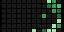
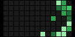

# GitHub Contributions

Your work, one little green square at a time.

GitHub Contributions brings your recent GitHub activity off the profile page and onto your Tidbyt or compatible Tronbyt display.

Watch a scrolling contribution heatmap reveal the rhythm of your projects: the busy stretches, the quiet weekends, and the small steps that add up to something worth building.

It’s part personal dashboard, part desk decoration, and a colorful reminder of the work behind the repositories.

## Display Previews

The app adapts its contribution grid to standard, wide 2×, and square displays.

### Standard Display — 64 × 32

A compact seven-row heatmap scrolls through your recent contribution history.



### Wide 2× Display — 128 × 64

The wide version uses larger contribution cells, giving the familiar green-square pattern a bolder presence.



### Square Display — 64 × 64

The square version vertically centers the compact contribution graph within the taller canvas.


## Features

- Recent contribution history — Displays up to 30 weekly columns from your contribution calendar.
- Seven-row heatmap — Each column represents a week, with Sunday at the top and Saturday at the bottom.
- GitHub-inspired greens — Daily contribution counts determine each cell’s shade.
- Smooth horizontal scrolling — Moves from older activity toward the most recent weeks with eased motion.
- A pause on recent activity — Holds the final view before a brief black transition and restart.
- Display-aware layout — Uses larger cells in 2× mode and vertical centering where space allows.
- Four-hour caching — Reuses successful results between normal refreshes.
- Last-successful-data fallback — Can keep displaying a previously retrieved calendar during a temporary API problem.
- Helpful error messages — Identifies missing settings and common authentication, access, and response problems.
- Private token field — The app’s settings mark your personal access token as secret.

## Before You Begin

You’ll need:

- A GitHub account.
- Your GitHub username—not your profile display name or email address.
- A GitHub personal access token.
- Network access to GitHub’s GraphQL API.

The app reads contribution-calendar data. It does not need permission to modify repositories or create commits.

## Setup

### 1. Create a Personal Access Token

The setup documented in the current app uses a personal access token (classic).

1. Sign in to GitHub.
2. Click your profile picture and select “Settings.”
3. Open “Developer settings.”
4. Select “Personal access tokens.”
5. Choose “Tokens (classic).”
6. Select “Generate new token,” then “Generate new token (classic).”
7. Give it a descriptive name, such as:
   `Tronbyt Contributions`
8. Choose an expiration, such as 90 days, or a duration allowed by your organization.
9. Select the `read:user` scope.
10. Click “Generate token.”
11. Copy the token immediately and store it securely.

GitHub only displays the newly generated token once.

Do not grant the broad `repo` scope just to follow this app’s documented contribution-calendar setup.

[GitHub’s personal access token instructions](https://docs.github.com/en/authentication/keeping-your-account-and-data-secure/managing-your-personal-access-tokens)

### Classic vs. Fine-Grained Tokens

These are different token types with different permission models:

| Token type | Typical prefix | Setup guidance here |
| --- | --- | --- |
| Personal access token (classic) | `ghp_` | Follow the `read:user` instructions above. |
| Fine-grained personal access token | `github_pat_` | Requires separate permission configuration; this app does not document a tested configuration. |

The app sends the token as a bearer credential, but that alone does not establish whether a particular fine-grained configuration can access the requested data.

If you already have a working fine-grained token, you do not need to replace it solely because of its prefix. The optional test below can help check whether your token returns the calendar.

### 2. Configure the App

1. Add GitHub Contributions to your display.
2. Open the app’s settings.
3. Enter your login name in “GitHub Username.”
4. Paste your token into “Personal Access Token.”
5. Save your settings.

For example, if your profile address is:

    https://github.com/YOUR_USERNAME

Enter only:

    YOUR_USERNAME

Do not include the URL or an `@` prefix.

### 3. Check the Result

The app should display a scrolling contribution grid.

If it shows an error instead, see the troubleshooting section below or test your credentials directly with the optional GraphQL request.

## Optional: Test Your Token with curl

This test requests a contribution calendar directly from GitHub, independently of the display app.

The following commands work in macOS Terminal using zsh. They prompt for your username and token so you don’t have to paste the token into a saved command.

The token prompt hides what you type.

```bash
printf 'GitHub username: '
read -r GITHUB_USERNAME
printf 'GitHub token (hidden): '
read -rs GITHUB_TOKEN
printf '\n'

printf 'Authorization: Bearer %s\n' "$GITHUB_TOKEN" |
curl --silent --show-error \
  --header @- \
  --header 'Content-Type: application/json' \
  --header 'Accept: application/vnd.github+json' \
  --data "{\"query\":\"query(\$u: String!) { user(login: \$u) { contributionsCollection { contributionCalendar { totalContributions weeks { contributionDays { date contributionCount weekday } } } } } }\",\"variables\":{\"u\":\"$GITHUB_USERNAME\"}}" \
  [https://api.github.com/graphql](https://api.github.com/graphql)

unset GITHUB_TOKEN GITHUB_USERNAME
```

This diagnostic query uses GitHub’s default contribution period. The app itself requests a recent period and displays up to 30 weekly columns.

### What a Successful Response Looks Like

Look for a JSON response containing this structure:

```json
{
  "data": {
    "user": {
      "contributionsCollection": {
        "contributionCalendar": {
          "totalContributions": 123,
          "weeks": []
        }
      }
    }
  }
}
```

The number above is only an example. A real successful response normally includes day entries inside the `weeks` array.

Check for an `errors` field as well. GraphQL can return an HTTP success status while reporting a query or permission problem in the JSON body.

Do not share your token when asking for help. Remove credentials and review any returned account information before posting diagnostic output.

## Reading Your Heatmap

Each cell represents a day. The app assigns a shade using fixed daily contribution-count thresholds:

| Daily contributions | Appearance |
| --- | --- |
| 0 | Dark gray |
| 1–2 | Light green |
| 3–4 | Medium-light green |
| 5–9 | Medium-dark green |
| 10 or more | Dark green |

Darker green represents more contributions—not necessarily a brighter-looking pixel.

Days without a supplied value appear black, distinct from valid zero-contribution days.

The palette is GitHub-inspired, but the app calculates its own levels from the returned counts rather than copying GitHub’s per-day color assignments.

## How the Animation Works

For a graph wider than the display, the app:

1. Pauses briefly on the older portion of the calendar.
2. Scrolls toward the newer weeks.
3. Holds the most recent portion.
4. Shows a brief black transition.
5. Repeats the animation.

If a returned graph fits within the display width, it does not need to scroll.

Animation playback is separate from data retrieval. Watching another loop does not trigger another GitHub request.

## Updates and Cached Data

Successful responses are normally cached for four hours.

The app also saves a last-successful response with a seven-day cache lifetime. If a later request fails, that backup can be used instead of immediately replacing the graph with an error.

A few important details:

- Fallback data is not visibly labeled as stale.
- A displayed graph does not prove that the latest refresh succeeded.
- Cache retention is best-effort; a backup may not always be available.
- Changing the username or token selects a separate cache context.
- The raw token is not placed in the cache key; a derived fingerprint distinguishes authentication contexts.
- When the normal cache is unavailable, failures can lead to repeated request attempts on subsequent renders. There is no separate error-retry backoff.

If you suspect the graph has stopped updating, check the app logs and your token’s validity.

## Private and Organization Contributions

The displayed calendar depends on what GitHub returns for the requested user and authentication context.

Private or internal contribution visibility can depend on:

- GitHub profile settings
- Token permissions
- Organization or enterprise policies
- Applicable authentication and authorization requirements

This app does not bypass those restrictions.

Do not automatically add broad permissions just because a count differs from what you expected. First compare the API response with your GitHub settings and the period being displayed.

## Troubleshooting

### “Enter username & token”

One or both settings are blank.

Enter your GitHub login name and a personal access token, then save.

### “Check GitHub token”

GitHub returned HTTP 401.

Check for an expired, revoked, incorrectly copied, or otherwise invalid token. Replace it in the app’s settings if necessary.

### “GitHub access/rate limit”

GitHub returned HTTP 403.

Check the response and logs for access restrictions, organization policies, or rate-limit information. This message alone does not identify which cause applies.

### “GitHub rate limit”

GitHub returned HTTP 429.

Reduce repeated testing or rendering attempts and follow GitHub’s retry guidance.

### “GitHub user not found”

Check the username.

Use the account’s login name, not its display name, email address, or complete profile URL.

### “GitHub query/access error”

The GraphQL response contained errors.

Run the optional test and inspect the returned error message. Review the token’s access without granting unnecessary permissions.

### The Graph Appears, but Seems Out of Date

The normal four-hour cache may still be active, or the app may be using its last-successful response after a failed refresh.

Check the logs and token expiration. The current display does not show a freshness timestamp.

## Token Security and Renewal

Treat your token like a password.

- Do not commit it to this repository.
- Do not include it in screenshots, issues, or public configuration examples.
- Use an expiration date.
- Replace the token in the app when it expires or is regenerated.
- Revoke and replace it immediately if exposed.
- Grant only the access needed for your use case.

Marking the app’s token field as secret helps prevent casual exposure in the interface; it does not make public sharing of the credential safe.

## Available Settings

| Setting | What it does |
| --- | --- |
| GitHub Username | Selects the account whose contribution calendar is requested. |
| Personal Access Token | Authenticates the GitHub GraphQL request. |

## Notes

- The graph shows contribution-calendar counts, not commits alone.
- It displays up to 30 recent weekly columns, not a full-year profile graph.
- Contribution counts and visibility are determined by GitHub’s returned data.
- The display does not show repository names, contribution details, or a numerical total.
- Colors, scrolling timing, and history length are currently defined in code rather than exposed as settings.
- Green squares are a record of activity—not a measure of the value of your work.

---

Small squares. Real projects. A little progress on display.

Created by Robert Ison.
