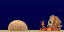
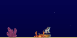
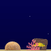

# Aquarium

All the underwater charm. None of the tank cleaning.

Aquarium transforms your Tidbyt or compatible Tronbyt display into a delightful little underwater escape. Colorful sea creatures cruise past coral, sunken treasures, and other ocean-floor curiosities while tiny bubbles drift toward the surface.

With randomly selected swimmers, changing decorations, and a choice of beautiful water colors, every newly generated scene brings a fresh little slice of ocean life to your desk, shelf, or favorite corner.

No feeding schedule. No filters. Just sit back and enjoy the view.

## Display Previews

Aquarium supports three display formats, adapting the scene to your device’s canvas.

### Standard Display — 64 × 32

A tiny tank with a big personality. The classic compact format packs swimming sea life, bubbles, and ocean-floor decorations into a cheerful little underwater window.

### Wide 2× Display — 128 × 64

More ocean to explore. The wide, higher-resolution format gives swimmers a longer journey and spreads the scene across a larger underwater canvas.

The artwork retains its native pixel dimensions rather than simply doubling in size, giving the aquarium a roomier feel.

### Square Display — 64 × 64

A taller window into your miniature ocean. The square format provides more vertical space between swimming lanes while keeping decorations anchored to the ocean floor.

## Features

- A changing cast of swimmers — Each newly generated scene randomly selects three distinct swimming subjects from the available collection.
- Seven sea-life characters — Enjoy clownfish, anglerfish, blue tang, lionfish, shark, blowfish, and cuttlefish.
- An optional visiting diver — Allow a diver to join the random selection, complete with occasional rising bubbles.
- Three randomly selected decorations — Each scene combines three different ocean-floor objects.
- Layered scenery — Rear decorations sit behind swimmers while foreground objects appear in front, adding a little pixel-art depth.
- Character-specific movement — Gentle bobbing and subtle width changes give different swimmers their own personalities.
- Varied swimming speeds — Staggered entrances and different speeds keep the procession from feeling like a synchronized parade.
- Rising ambient bubbles — Tiny bubbles drift upward with a gentle side-to-side motion.
- Shaded water — Colored backgrounds darken subtly toward the ocean floor.
- Thirteen water colors — Choose your favorite atmosphere, from bright Aqua to Midnight Ocean.
- Random water mode — Let the app select from a curated set of background colors whenever a new scene is generated.
- A true black background option — Enjoy the colorful artwork against solid black, without a water gradient.
- Three display formats — Support for standard 64 × 32, wide 128 × 64, and square 64 × 64 panels.

## Meet the Residents

The swimming cast includes:

- Clownfish
- Anglerfish
- Blue tang
- Lionfish
- Shark
- Blowfish
- Cuttlefish
- Diver, when enabled

Three different subjects are selected for each generated scene. Enabling the diver makes it eligible for selection—it does not guarantee an appearance.

The shark keeps a steady, level course, while other residents bob gently as they swim. The blowfish, cuttlefish, and diver each have their own movement timing, adding a little variety to life beneath the pixels.

## Explore the Ocean Floor

Every aquarium needs a little character beyond its residents.

The app randomly selects three decorations from this collection:

- Brain coral
- Finger coral
- Tube coral
- Shipwreck
- Diving helmet
- Anchor
- Crab
- Treasure chest

Decoration placement varies between scenes. Foreground objects are positioned to reduce overlap where possible, while the tallest selected decoration forms a rear layer for a sense of depth.

A sandy bottom ties the whole scene together—because even a digital ocean deserves a proper floor.

## Set the Mood

Choose a water color to match your room, your display, or your mood.

| Water color | Atmosphere |
| --- | --- |
| Aqua | Bright and playful |
| Deep Sky Blue | A classic blue-water look |
| Aquamarine | A fresh green-blue glow |
| Light Blue | A pale, airy backdrop |
| Very Dark Blue | A deep-water feel |
| Dark Turquoise | A vibrant tropical touch |
| Turquoise | A colorful coastal mood |
| Ocean Blue | Rich underwater blue |
| Deep Teal | A subdued blue-green setting |
| Midnight Ocean | Dark and atmospheric |
| Lagoon | A welcoming tropical escape |
| Kelp Forest | A green-toned underwater world |
| Black | Solid black for colorful pixel-art contrast |

Can’t decide? Choose “Random” and let the aquarium surprise you.

Random mode uses a curated subset of the palette. Aquamarine, Light Blue, and Turquoise remain available for manual selection but are excluded from random selection.

All colored backgrounds use a subtle top-to-bottom shading effect. Black stays completely black.

## Get Started

No accounts, API keys, external feeds, or aquarium expertise required.

1. Add Aquarium to your display.
2. Open the app’s settings.
3. Choose a “Water Color,” or leave it set to “Random.”
4. Decide whether to enable “Allow Diver.”
5. Save your settings and enjoy your miniature underwater escape.

## Available Settings

| Setting | What it does |
| --- | --- |
| Water Color | Selects a fixed water color or enables random color selection. Defaults to Random. |
| Allow Diver | Allows a diver to be randomly selected as one of the three swimming subjects. Enabled by default. |

## A Fresh Scene, Not Just a New Lap

The swimmers, decorations, decoration positions, and random water color are chosen when the app generates a new animation.

Replaying an existing animation repeats that scene. A subsequent app render can produce a new combination of residents and scenery.

The animation length adapts to the selected swimmers and display width so that every swimming subject has time to cross the screen and leave the scene.

## Notes

- Swimmers and decorations are selected randomly; individual species and objects cannot be chosen in settings.
- Three distinct swimming subjects and three distinct decorations are selected per generated scene.
- The diver toggle controls eligibility, not guaranteed visibility.
- Artwork retains its native pixel dimensions across display formats; larger displays provide more space rather than uniformly enlarged sprites.
- Bubbles take their color from the selected water background for a coordinated underwater look.

---

Your own little ocean. Absolutely no water changes.

Created by Robert Ison.
