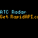

# ATC Radar

A little window into the busy skies above you.

ATC Radar turns your Tidbyt or compatible Tronbyt display into a compact, radar-style view of nearby aircraft. Green aircraft markers, flashing heading indicators, and a yellow marker for your selected location bring the surrounding air traffic to life in a wonderfully minimal display.

Whether you live beneath a busy approach path or simply love wondering where that airplane overhead is going, ATC Radar adds a little aviation magic to your everyday surroundings.

Choose your location, set your viewing radius, and enjoy the traffic—with update settings that fit your API allowance.

## Display Previews

### Standard Display — 64 × 32

A compact radar-style view for standard-resolution displays, with aircraft positions, heading indicators, and an optional information bar.

### Square Display — 64 × 64

A taller radar canvas for square panels, giving nearby aircraft more vertical room on the display.

## Features

- Nearby aircraft positions — See aircraft returned by the data provider within your selected display radius.
- Flashing heading indicators — An adjacent flashing pixel indicates each aircraft’s direction of travel.
- Altitude-based brightness — Lower-altitude aircraft have brighter heading indicators; higher aircraft have dimmer ones.
- Your selected location — A yellow marker shows your reference position.
- Adaptive framing — The display adjusts its geographic bounds to accommodate nearby aircraft and your location.
- Adjustable viewing radius — Choose 1, 5, 10, 20, 50, 75, or 100 kilometers.
- Cached aircraft data — Reuse fetched data between updates to reduce API requests.
- Adjustable update interval — Choose intervals from one minute to one hour.
- Optional information bar — See the nearest aircraft’s relative distance and the age of the cached data.
- Hide older data — Stop displaying aircraft when the cached data exceeds your chosen age.
- Hide when quiet — Optionally omit the app when no aircraft are within the selected radius.
- On-device instructions — Enable scrolling help from the settings.

## Before You Begin

ATC Radar requires your own RapidAPI key and access to the Flight Radar API provided by API DOJO.

[Open the Flight Radar API pricing and subscription page](https://rapidapi.com/apidojo/api/flight-radar1/pricing)

At the time this README was updated, the Basic plan listed:

- $0 monthly subscription price
- 500 requests per month
- A hard request limit

Plans and allowances can change. Check the current pricing page and your own subscription dashboard before choosing your settings.

The older 1,000-request allowance mentioned in previous documentation should not be assumed to apply to your account.

## Get Started

1. Create or sign in to your RapidAPI account.
2. Subscribe to an appropriate plan for API DOJO’s Flight Radar API.
3. Copy your RapidAPI application key.
4. Add ATC Radar to your display.
5. Enter the key in “RapidAPI FlightRadar Key.”
6. Select your location and preferred distance.
7. Set “Update Frequency” using the request-budget guidance below.
8. Choose when the app should hide older data.
9. Save your settings and check your usage in RapidAPI after the app has been running.

Keep your API key private. Do not include it in screenshots, public configuration files, or repository commits.

## Keeping Requests Within Your Monthly Allowance

The most important setting is “Update Frequency.”

Despite its name, this setting controls how long fetched aircraft data remains cached. While cached data is available, the app reuses it. When the cache is missing or expires, the next app render requests fresh data.

A shorter interval means fresher aircraft positions—but more API calls.

The default interval is five minutes. That is not a suitable budget setting for continuous use on a 500-request monthly plan.

### Estimate Your Monthly Requests

Use this planning formula:

    Estimated monthly requests =
        Active hours per day × 60 × Days in billing period
        ÷ Update interval in minutes

For example, running eight hours per day with a 45-minute update interval over 31 days gives:

    8 × 60 × 31 ÷ 45 ≈ 331 requests

This is a planning estimate, not a hard cap. Cache misses, restarts, testing, additional installations, and the timing of scheduled activity can change actual usage.

Use the number of days in your billing period—not necessarily the calendar month.

### Suggested Settings for a 500-Request Allowance

These examples assume one effective request stream, a 31-day period, and that the stated schedule actually stops the app from rendering outside its active hours.

| Active hours per day | Update Frequency | Estimated requests per 31 days |
| --- | --- | --- |
| 4 hours | 20 minutes | 372 |
| 6 hours | 30 minutes | 372 |
| 8 hours | 45 minutes | About 331 |
| 10 hours | 45 minutes | About 413 |
| 12 hours | 1 hour | 372 |

These settings leave some room for testing and unexpected requests. They are not guarantees.

Avoid planning right up to the full allowance. A useful target is approximately 400 requests out of a 500-request budget, leaving the remainder as a buffer.

### Can I Run It Around the Clock on the Free Plan?

Not within the nominal request budget using the current settings alone.

The longest available update interval is one hour. Continuous operation over 31 days would therefore require approximately:

    24 × 31 = 744 requests

That exceeds a 500-request allowance.

For continuous operation, you would need an appropriate higher-allowance plan or a code change to support longer cache intervals.

### Calculate Your Own Interval

To find a minimum planning interval:

    Minimum interval in minutes =
        Active hours per day × 60 × Days in billing period
        ÷ Request budget

Use a request budget below your plan’s actual limit, then round up to the next available interval.

For example, with eight active hours per day and a target budget of 400 requests:

    8 × 60 × 31 ÷ 400 = 37.2 minutes

Choose 45 minutes, the next available setting above 37.2 minutes.

If the result exceeds 60 minutes, the current settings cannot meet that budget without reducing active hours.

## What Does—and Does Not—Save API Calls

### Longer Update Intervals Save Calls

Increasing “Update Frequency” keeps data cached longer, reducing how often the app normally requests fresh aircraft information.

### Hiding the App Is Not the Same as Stopping Requests

“Hide app when no flights nearby?” and “Hide when data older than:” control what appears on the display.

They do not disable data retrieval. The app checks or fetches aircraft data before deciding whether to hide its output.

An empty sky can still use API calls.

### Turning Off the Display May Not Stop Background Rendering

A dark screen, device sleep mode, or removal from the visible rotation does not by itself prove that the hosting system has stopped rendering the app.

If you rely on a schedule to control usage, verify in the RapidAPI dashboard that requests actually stop outside the intended hours.

### A Smaller Viewing Radius Does Not Reduce the Call Count

The app fetches aircraft data for a bounding area calculated around your location using a fixed 100-kilometer distance, then filters the returned aircraft to your selected viewing radius.

Selecting 1 kilometer instead of 100 kilometers changes the displayed traffic, not the number of API requests per cache refresh.

### Other Uses of Your Subscription Matter

Testing requests in RapidAPI, running additional app instances, and using the same subscription elsewhere can consume the same allowance.

Do not assume that multiple installations share a cache. Monitor total usage in the provider dashboard.

### There Is No Built-In Monthly Usage Cap

The app does not track your remaining monthly allowance or automatically stop at a user-defined request budget.

Your provider’s dashboard and subscription limits remain the source of truth.

Failed requests are not cached by the current code, so repeated errors may also generate repeated attempts. If requests begin failing, investigate rather than leaving the app retrying indefinitely.

## Balancing Freshness and Budget

Aircraft move quickly. Data cached for 30–60 minutes is a historical snapshot, not a current picture of the sky.

The “Hide when data older than:” setting lets you avoid displaying that snapshot for the entire cache period.

For example:

- Set “Update Frequency” to 45 minutes.
- Set “Hide when data older than:” to 5 minutes.

After a successful fetch, aircraft can appear for approximately five minutes. The app then hides that older data until a subsequent render fetches new information after the cache expires.

This reduces the time stale positions remain visible. It does not trigger an earlier refresh or reduce the normal cache-refresh request budget.

Use short update intervals only if your subscription allowance supports them.

## Reading the Radar

### Yellow Marker: Your Location

The yellow marker represents your selected reference location.

It is not always centered. The map adjusts its framing to make use of the display area.

### Green Markers: Aircraft

Green markers show aircraft positions from the fetched dataset.

A flashing adjacent marker indicates heading. It is a directional cue, not continuously tracked movement or a prediction of the aircraft’s present position.

Brighter heading indicators represent lower-altitude aircraft. Dimmer indicators represent higher-altitude aircraft.

### Information Bar: Distance and Data Age

The optional bottom bar communicates two things.

Its length represents the nearest aircraft’s distance as a fraction of your selected radius.

For example:

- Selected radius: 100 kilometers
- Nearest aircraft: 25 kilometers away
- Bar length: approximately 25% of the display width

A shorter bar means the nearest aircraft is closer to your location relative to the selected radius.

Its color represents elapsed time within your selected cache interval:

| Color | Cached data age |
| --- | --- |
| Green | First third of the update interval |
| Yellow | Middle third of the update interval |
| Red | Final third of the interval |

These colors are relative to your chosen interval. Green does not necessarily mean the data is only seconds old.

## Available Settings

| Setting | What it does |
| --- | --- |
| RapidAPI FlightRadar Key | Supplies your private RapidAPI key. |
| Location | Sets the reference position for nearby traffic. |
| Distance | Filters displayed aircraft by distance from your location. Defaults to 5 kilometers. |
| Update Frequency | Sets the cache lifetime between normal data refreshes. Defaults to 5 minutes. |
| Hide when data older than: | Hides aircraft data exceeding the selected age. Defaults to 15 minutes. |
| Information Bar | Shows nearest-aircraft relative distance and cache-age color. Enabled by default. |
| Hide app when no flights nearby? | Omits the app when no aircraft meet the distance filter. Enabled by default. |
| Display Instructions | Shows scrolling setup and interpretation help instead of the radar. |

## Important Limitations

- This is an aviation-interest display, not an operational air traffic control system.
- Do not use it for navigation, aircraft separation, or safety decisions.
- Traffic visibility depends on the provider’s coverage and returned data.
- The current API request applies an altitude filter of 1,000–60,000 feet; this is not an airport surface-traffic display.
- Aircraft positions remain snapshots until new data is fetched.
- Display framing can change between datasets, so the radar does not maintain a fixed geographic scale.
- Cached data may disappear early or be unavailable; cache lifetime is not a guaranteed billing safeguard.
- Check your subscription’s current limits, billing period, and usage regularly.

---

A little aviation wonder, right on your display.

Created by Robert Ison.
