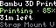
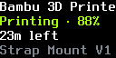

# Bambu Printer Status

Your printer is busy creating something awesome. Now your display can keep you in the loop.

Bambu Printer Status turns your Tidbyt or compatible Tronbyt display into a colorful, at-a-glance companion for your Bambu printer. Follow your print’s progress, see when it should finish, and celebrate that freshly completed masterpiece—all without reaching for your phone or opening your slicer.

Whether you're running a quick little accessory or settling in for a marathon print, the important details are always just a glance away.

## Display Previews

The app supports three display formats, adapting its presentation to your device.

### Standard Display — 64 × 32

The classic compact layout for standard-resolution Tidbyt and compatible Tronbyt displays. Printer status and scrolling job details fit neatly into a small but mighty dashboard.

### Wide 2× Display — 128 × 64

The higher-resolution wide version uses a larger font and a layout suited to a 128 × 64 display, keeping the same useful information readable on a bigger canvas.

### Square Display — 64 × 64

The square version centers the compact status dashboard on a 64 × 64 panel.

## Features

- Color-coded printer status — Quickly distinguish printing, paused, idle, offline, and error states.
- Print progress — See the current completion percentage when supplied by your status feed.
- Scrolling job details — Display the job name, plate name, and printed objects when available.
- Time remaining — Keep an eye on how much longer your current print has to go.
- Estimated finish time — See an estimated completion time in your configured time zone, including tomorrow or a later date for longer prints.
- Recent-completion highlight — Show “Finished” for 30 minutes after a recorded completion.
- Last-print details — While idle, see the most recently completed job and its duration when available.
- Idle-time tracking — See how long your printer has been waiting for its next assignment.
- Printer selection — Choose which printer to display when your JSON feed includes multiple printers.
- Adjustable scrolling — Choose slow, medium, or fast scrolling.
- Active-print-only mode — Hide idle and completed prints while keeping errors and enabled data warnings visible. An additional option lets offline printers remain visible.
- Data-freshness warnings — Warn when timestamped status data is more than five minutes old, with a prominent “STALE DATA” status after 15 minutes.
- Clock checks — Flag relevant timestamps that appear too far in the future.
- On-device setup help — Enable scrolling setup instructions from the app’s settings.
- Three display formats — Support for standard 64 × 32, wide 128 × 64, and square 64 × 64 panels.

Available details depend on the information supplied by your status feed.

## Setup: A Little Effort, a Lot of Everyday Awesome

This app takes a little more setup than simply adding it to your display—but the payoff is your own dedicated, glanceable printer dashboard.

The app reads printer information from a `status.json` file served over HTTP. It does not connect directly to your printer. You’ll first need to set up the process that collects your printer information, updates that file, and makes it accessible to the app.

The complete setup process is covered in the PDF guide:

[Open the Bambu Printer Status JSON Setup Instructions (PDF)](bambu_printer_status_json_setup_instructions.pdf)

The guide covers creating the status feed with the provided Python script, scheduling updates, and serving the resulting JSON file over HTTP.

### Setup Overview

1. Follow the PDF guide to create your printer status JSON feed.
2. Schedule the feed to update every minute.
3. Serve `status.json` at an HTTP address the app can reach.
4. Enter the full address in the app’s “Status JSON URL” setting.
5. Select your printer from the generated printer list.
6. Adjust scrolling and display options to your liking.
7. If you enabled “Show Setup Instructions,” turn it off to display printer status.

Once configured, your display becomes a handy little window into your printer’s world—quietly keeping you informed while your next creation takes shape.

## Available Settings

| Setting | What it does |
| --- | --- |
| Show Setup Instructions | Displays on-device setup help instead of printer status. |
| Status JSON URL | The full HTTP address of your `status.json` feed. |
| Printer | Selects a printer from those included in the feed. |
| Scroll | Sets scrolling to slow, medium, or fast. |
| Only During Active Prints | Hides idle and recently completed prints; errors and enabled data warnings remain visible. |
| Always Show Offline | Keeps offline printers visible when active-print-only mode is enabled. |
| Estimated Finish Time | Adds an estimated local completion time while printing. |
| Highlight Recent Completion | Shows “Finished” for 30 minutes after a recorded completion. |
| Warn About Old Data | Enables stale-data and timestamp warnings. |

## Notes

- Status accuracy and freshness depend on the process updating your JSON feed.
