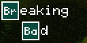
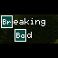

# BreakingBad

Your name. A little chemistry. A whole lot of character.

BreakingBad gives your Tidbyt or compatible Tronbyt display a personalized title-card treatment inspired by the unmistakable Breaking Bad style.

Enter two lines of text and watch ordinary letters take on a little chemical personality. The app finds matching periodic-table symbols and frames them in green element-style tiles, turning your name—or another short phrase—into a miniature opening credit.

Add the animated smoke background for extra atmosphere, or keep things clean and let the lettering do the talking.

No laboratory required.

## Display Previews

The app uses a compact 64 × 32 title-card composition, centered within the available display canvas.

### Standard Display — 64 × 32

The original compact presentation: two lines of personalized text, green element-style tiles, and optional animated smoke.

### Wide 2× Canvas — 128 × 64

The same compact title-card composition on a larger, wide canvas.

The current layout retains its 64 × 32 dimensions rather than enlarging the text and element tiles to fill the display.

### Square Display — 64 × 64

A centered title card on a taller square panel, preserving the original composition without stretching the artwork.

## Features

- Personalized two-line text — Use your first and last name, a nickname, or another short phrase.
- Automatic element matching — The app searches each line for a valid chemical element symbol.
- Two-letter symbol priority — Two-letter matches are checked before single-letter matches.
- Green element-style tiles — Matching symbols appear inside green boxes with white borders.
- Optional animated smoke — Add a little opening-credit atmosphere behind your text.
- Plain-text fallback — Lines without a matching symbol remain readable as ordinary text.
- Centered composition — The compact title-card layout is centered within larger canvases.
- Self-contained rendering — Text formatting and the bundled smoke animation require no external data feed or API key.

## Make It Personal

Your name is a natural starting point—but it doesn’t have to stop there.

Try:

- Your first and last name
- A nickname and surname
- A short two-word phrase
- A name for your desk, workshop, or creative corner

Shorter text works best. This is a tiny title card, not the closing credits.

## How the Chemistry Works

Each line is processed independently.

The app:

1. Looks for a matching two-letter element symbol, searching from left to right.
2. If no two-letter match exists, looks for a one-letter symbol.
3. Places the first match from that search inside a green tile.
4. Displays the remaining text around it.

Matching ignores the input’s capitalization, and the selected symbol is displayed using standard element-symbol capitalization.

Only one element tile is created per line.

### Example

With the default text:

- “Breaking” highlights “Br” for Bromine.
- “Bad” highlights “Ba” for Barium.

You don’t need to type element symbols in a special way. Just enter your text and let the app find the chemistry.

### Why Did It Choose That Symbol?

Two-letter symbols take priority over single-letter symbols—even when a single-letter match occurs earlier in the text.

The app chooses the first match according to that rule, rather than selecting a symbol randomly or trying to create the largest number of tiles.

There is no setting to manually choose the highlighted symbol.

## A Little Smoke, a Little Drama

Enable “Show background image?” to display the bundled animated smoke behind the lettering.

Prefer a simpler look? Turn it off for text and element tiles against a plain background.

The smoke is a visual effect only. It does not require a network connection or an external animation service.

## Get Started

1. Add BreakingBad to your display.
2. Open the app’s settings.
3. Enter your preferred text in “Line 1.”
4. Enter your second line in “Line 2.”
5. Enable “Show background image?” if you want the animated smoke.
6. Save your settings and enjoy your personalized title card.

If text extends beyond the display, shorten the wording and try again.

## Available Settings

| Setting | What it does |
| --- | --- |
| Line 1 | Sets the first line of text, typically a first name. |
| Line 2 | Sets the second line of text, typically a last name. |
| Show background image? | Toggles the animated smoke background. |

## Tips for the Best Result

- Keep both lines short so the complete title fits within the compact layout.
- Experiment with nicknames or alternate wording to discover different element matches.
- Remember that spaces occupy layout width, even though surrounding text segments are trimmed for display.
- Use the smoke background for atmosphere or disable it for a simpler presentation.

## Notes

- Text does not automatically shrink, wrap, or scroll to fit.
- Long lines may be clipped.
- Each line can contain a maximum of one highlighted element symbol.
- Element tiles display the symbol, not an atomic number or the full element name.
- The current artwork remains a 64 × 32 composition on larger canvases.
- This is a fan-inspired visual app, not an official Breaking Bad product.

---

A small display with undeniable chemistry.

Created by Robert Ison.
