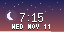
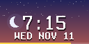
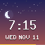

# Celestial Clock

A clock over a sky that follows the time of day. The sky shifts from night through dawn, day, and dusk. A sun arcs across from 6:00 to 18:30, and a crescent moon and twinkling stars take over after dark. The time is large, the date sits under it, and a bar along the bottom edge fills as the day passes.

| Size      | Preview                                 |
|-----------|-----------------------------------------|
| **1x**    |              |
| **2x**    |           |
| **64x64** |     |

## Options

- **Location:** sets the timezone. Leave it blank to use the device's.
- **24-hour clock:** on for 24-hour time.

Keep the app's render interval at 0 so the time is current each time it comes up. The minute changes on time while the app is on screen.
