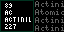
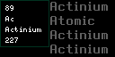
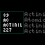

# Chemical Elements

A tiny display. An entire universe of building blocks.

Chemical Elements turns your Tidbyt or compatible Tronbyt display into a colorful little window into the periodic table.

Discover a different element, revisit a familiar favorite, and put a little everyday science on your desk. Each featured element combines a classic periodic-table-style tile with additional details, making your display equal parts conversation starter and bite-sized learning companion.

From Hydrogen to Oganesson, there’s a whole table of discoveries waiting to light up your day.

## Display Previews

Chemical Elements supports three display formats.

### Standard Display — 64 × 32

A compact chemistry companion for standard-resolution displays. The element’s periodic-table-style tile appears alongside additional information, bringing a surprising amount of science to a small canvas.

### Wide 2× Display — 128 × 64

The higher-resolution wide format provides a larger canvas for your daily dose of chemistry.

### Square Display — 64 × 64

The square version centers the element presentation within a taller panel, preserving the compact arrangement without stretching it vertically.

## Features

- One element in the spotlight — Explore the periodic table one entry at a time.
- Random discovery mode — Select a random element whenever the app runs.
- Daily discovery mode — Follow a repeating 118-day journey through the elements.
- Periodic-table-style presentation — See the element’s atomic number, symbol, name, and atomic mass together.
- Additional element details — Learn more about the featured element beyond its symbol.
- Category-based colors — Element categories have their own assigned colors.
- Bundled element data — Element information is included in the app rather than fetched from an external API.
- Three display formats — Support for standard 64 × 32, wide 128 × 64, and square 64 × 64 panels.

## Choose Your Discovery Style

### Random Mode

Prefer a little scientific serendipity?

Random mode selects an element each time the app runs. One appearance might introduce something unfamiliar; another might bring back an old favorite.

Random selection can repeat elements. It is not a checklist that removes previously displayed entries.

### Daily Mode

Enjoy a more methodical journey through the periodic table.

Daily mode features one element per day, progressing through a repeating 118-day cycle. Follow along each day and you’ll encounter every element before the cycle begins again.

It’s a simple way to turn a passing glance at your display into a small daily discovery.

## Reading the Display

The periodic-table-style tile brings the featured element’s core identifying information together:

| Detail | What appears |
| --- | --- |
| Atomic number | The element’s identifying number in the periodic table |
| Symbol | Its one- or two-letter chemical symbol |
| Name | The element’s name |
| Atomic mass | The mass value stored in the app’s dataset |

Additional information appears alongside the tile in the wide presentation.

The bundled dataset includes fields for:

- Group
- Period
- Element category
- State at room temperature
- Melting point
- Boiling point

The app presents information from this included dataset; it does not query a live chemistry reference service.

## A Little Colorful Chemistry

Element categories have assigned colors, adding visual variety as different elements appear.

The app’s category palette includes:

- Nonmetals
- Noble gases
- Alkali metals
- Alkaline earth metals
- Metalloids
- Halogens
- Basic metals
- Transition metals
- Lanthanoids
- Actinoids

These category names reflect the terminology used in the app’s dataset.

## Get Started

No API keys, subscriptions, or external data feeds are required.

1. Add Chemical Elements to your display.
2. Open the app’s settings.
3. Choose random selection or the daily element cycle.
4. Save your settings.
5. Enjoy a little chemistry whenever the app appears.

Choose random mode for variety between runs, or daily mode for a slower, more structured tour.

## Made for Curious Minds

Chemical Elements makes a natural addition to:

- A science enthusiast’s desk
- A classroom or study corner
- A workshop with a curious streak
- A display rotation that could use a little more discovery

You don’t need to memorize the periodic table to enjoy it. Sometimes learning starts with noticing a symbol you haven’t thought about in years.

## Notes

- Random mode can select the same element more than once.
- Daily mode repeats after its 118-day cycle.
- A rendered preview shows the element selected for that render; replaying the same image does not select another element.
- Element information comes from the bundled dataset and changes only when that data is updated.
- Some physical-property values depend on conditions or may be estimates. Treat the app as a casual educational display rather than a laboratory reference.

---

Put a little discovery in your daily rotation.

Created by Robert Ison.
