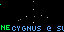
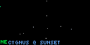
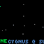

# Constellations

A little starlight. A little wonder. A reason to look up.

Constellations turns your Tidbyt or compatible Tronbyt display into a miniature companion to the night sky.

Using your observing location and the time, the app selects a constellation above your horizon and brings its star pattern to life with gentle twinkling. A direction label tells you which way to face, while an optional altitude indicator offers a simple guide to how high to look.

Checking during the day? The app can look ahead to sunset, giving you a small preview of the sky to come.

It’s a little invitation to step outside, let your eyes adjust, and reconnect with the stars.

## Display Previews

Constellations supports three display formats. Star patterns are scaled to fit the available area while preserving their projected proportions.

### Standard Display — 64 × 32

A pocket-sized patch of sky for standard-resolution displays, complete with twinkling stars, a direction label, and a scrolling constellation name.

### Wide 2× Display — 128 × 64

A larger, wide canvas gives the projected star pattern more room. Stars remain individual pixels, while the layout uses the available display dimensions.

### Square Display — 64 × 64

The square format provides a taller star field, with the direction and constellation name positioned along the bottom.

## Features

- Location-aware selection — Calculates constellation positions for your chosen observing location.
- Above-horizon star patterns — Only plots the included stars that are above the calculated horizon.
- Daytime sunset previews — During daytime before a calculated sunset, shows a constellation’s position at sunset rather than its current daytime position.
- Gentle animated twinkling — Stars vary subtly in brightness and cool-toned color without disappearing.
- Direction guidance — A green compass label tells you which way to face.
- Optional altitude indicator — A green dot shows the constellation’s approximate height above the horizon.
- Scrolling constellation names — Blue text identifies the featured pattern.
- Higher-sky preference — Prioritizes qualifying constellations whose reference positions are more than 30 degrees above the horizon, with a 15-degree fallback.
- Minute-based selection — The selection can change when a new minute is rendered, while remaining stable within that minute under unchanged conditions.
- Proportion-preserving layout — Fits each projected pattern to the screen without independently stretching its width and height.
- Bundled star data — Uses included constellation data and local calculations rather than an external sky-data API.
- Three display formats — Support for standard 64 × 32, wide 128 × 64, and square 64 × 64 panels.

## Your Sky, Your Location

Set your observing location in the app’s settings.

The app uses its latitude and longitude to calculate where the included stars lie relative to your horizon. The location’s time zone also helps determine the local date used for sunset calculations.

There’s no need to enter celestial coordinates or choose a constellation manually. The app evaluates its included collection and selects a qualifying pattern for you.

If no location is supplied, the code falls back to Orlando, Florida. Set your own location for a sky that matches where you are.

## Reading the Display

### Twinkling Stars

The main display shows the featured constellation’s included above-horizon stars as individual points.

The pattern is projected for the selected location and time, then scaled to fit the screen. Its orientation follows the local sky projection rather than a fixed illustration.

Stars gently brighten and dim in staggered phases, adding a little life without blinking out completely.

### Green Letters: Which Way to Face

The green label along the bottom gives an approximate compass direction for the constellation’s reference position.

Examples include:

- N — North
- NE — Northeast
- SSW — South-southwest
- W — West
- UP — Nearly overhead

The app uses 16 compass directions. “UP” appears when the reference position is at least 88 degrees above the horizon.

### Green Dot: How High to Look

When enabled, the green dot along the left edge represents the constellation’s approximate altitude within the star-display area.

| Dot position | Approximate meaning |
| --- | --- |
| Bottom | Near the horizon |
| Middle | About halfway from the horizon to overhead |
| Top | Near overhead |

This indicator describes the constellation’s reference position, not the height of every individual star.

### Blue Text: What You’re Seeing

The blue scrolling label identifies the featured constellation.

When you see “@ sunset” after its name, the app is showing a sunset preview—not its current position.

## A Preview Before the Stars Come Out

During daytime, the app checks whether a sunset is calculated for the local date and still lies ahead.

When those conditions are met, it evaluates the sky at sunset and labels the selected constellation accordingly.

This gives you something useful to explore before night arrives, rather than presenting daytime star positions as though they were readily visible.

Sunset is not the same as full darkness. A constellation above the horizon at sunset may not become easy to see until the sky darkens further.

If no applicable sunset is available, the app evaluates the current time instead.

## How Constellations Are Selected

The app looks for patterns with enough of their included stars above the horizon to make a useful display.

A candidate must have:

- At least half of its included stars above the horizon.
- At least three included stars above the horizon, or all of them if the pattern contains fewer than three.
- A reference position above the current selection threshold.

It first tries a reference-altitude threshold of 30 degrees. If no candidates qualify, it tries 15 degrees.

If nothing qualifies, the app displays a message rather than showing an unsuitable pattern.

Selection is randomized using a time-based seed. A new minute can produce a different constellation, but repeats are possible.

## Get Started

No API keys, subscriptions, or external star-data feeds are required.

1. Add Constellations to your display.
2. Open the app’s settings.
3. Set your observing location.
4. Leave “Display Altitude Indicator” enabled if you want height guidance.
5. Save your settings and enjoy your miniature star field.
6. Look for “@ sunset” to distinguish a daytime preview from a current-time view.

Need a refresher? Enable “Display Instructions” for scrolling help, then turn it off to return to the stars.

## Available Settings

| Setting | What it does |
| --- | --- |
| Location | Sets your observing location. |
| Display Altitude Indicator | Shows a green dot representing approximate height above the horizon. Enabled by default. |
| Display Instructions | Shows scrolling help instead of a constellation. Disabled by default. |

## A Small Sky, Not a Full Planetarium

Constellations is designed to inspire recognition and curiosity, not replace a detailed observing chart.

Keep these limitations in mind:

- Above the horizon does not guarantee visibility. Clouds, daylight, twilight, light pollution, terrain, and buildings can obscure stars.
- The display uses the stars included in the app’s dataset, not every star within a constellation’s official boundaries.
- Each pattern is scaled to fit the display; different constellations do not share a fixed angular scale.
- Nearby stars can land on the same pixel. When that happens, the brighter-ranked marker takes priority.
- Brightness uses supplied brightness information when available; otherwise, it uses a stable display ranking rather than measured stellar brightness.
- Twinkling is an artistic animation, not a live measurement of atmospheric conditions.
- Star positions are calculated when the app renders. Replaying an existing animation does not continuously recalculate the sky.
- A qualifying constellation may have some of its included stars below the horizon; those stars are omitted.
- The app does not check live weather or observing conditions.

---

Bring a little of the night sky indoors—and a little curiosity back outside.

Created by Robert Ison.
