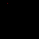

# Cursive

A little handwriting magic, one pixel at a time.

Cursive turns your Tidbyt or compatible Tronbyt display into a tiny digital writing canvas. Instead of simply showing your message, it writes it out—tracing the included cursive letter patterns pixel by pixel.

Watch a name, a greeting, or a favorite little phrase take shape in your chosen color. As the writing reaches the edge, the canvas shifts left to make room for what comes next.

It’s a simple idea with a wonderfully personal touch: your words, a splash of color, and the quiet satisfaction of watching them come to life.

## Display Previews

Cursive uses the available canvas dimensions to determine how much writing fits on screen.

### Standard Display — 64 × 32

A compact handwritten message for standard-resolution displays. Longer text shifts left as new letters are drawn.

### Wide 2× Display — 128 × 64

The wider canvas leaves more room for your message before the writing begins to shift.

Letter coordinates retain their native pixel dimensions rather than automatically doubling in size.

### Square Display — 64 × 64

The same handwriting animation on a taller square canvas.

The current code preserves the letter patterns’ original vertical coordinates rather than vertically centering or enlarging the writing.

## Features

- Your own message — Enter the words you want the app to write.
- Pixel-by-pixel handwriting — Each supported character is traced in its recorded drawing order.
- Automatic horizontal scrolling — Completed writing shifts left when new strokes reach beyond the screen.
- Custom pen color — Choose a color that suits your message, room, or mood.
- Three animation speeds — Select slow, medium, or fast drawing and scrolling.
- A finishing pause — The final visible portion of your message holds briefly before the animation repeats.
- Bundled letter patterns — Handwriting comes from the included coordinate data, not an external font service.
- Self-contained rendering — No API keys, accounts, or external data feeds are required.
- Three preview formats — Standard 64 × 32, wide 128 × 64, and square 64 × 64.

## Make It Personal

A small display doesn’t need a long message to say something meaningful.

Try:

- A first name or nickname
- A friendly greeting
- A short celebration
- A little encouragement
- A welcoming message for your desk
- A reminder that makes you smile

Short messages are quick to enjoy. Longer messages turn the display into a small, unfolding note.

The default message is:

> What a Great App

A modest sentiment, beautifully written.

## How the Writing Works

Each supported character is stored as an ordered sequence of pixel coordinates.

The app draws those points one at a time, leaving earlier points visible as the next strokes appear. After completing a character, it advances the writing position using that letter’s final recorded point.

This gives the animation its handwritten character. It isn’t simply revealing an ordinary font through a moving window—the drawing order is part of each letter’s design.

### When the Message Reaches the Edge

As the rightmost drawn point reaches beyond the display width, the app shifts the accumulated writing left to keep the newest strokes visible.

Earlier text eventually moves off the left edge. The message stays on one horizontal writing line rather than wrapping into multiple rows.

### At the End

Once the message is complete, the final visible portion holds briefly.

The pause follows the selected animation speed, so slower writing also produces a longer finishing hold.

## Choose Your Ink

The “Color” setting controls the entire message.

The default is a bright yellow, but you can choose a different color to match your display’s surroundings or give your words a different personality.

Try a soft blue greeting, a cheerful green reminder, or a bold pink celebration. The lettering stays yours; the ink is up to you.

## Set the Pace

The “Scroll Speed” setting controls the delay between animation frames, affecting both the drawing and the scrolling.

| Setting | Frame delay | Feel |
| --- | --- | --- |
| Slow Scroll | 60 milliseconds | A more leisurely reveal |
| Medium Scroll | 45 milliseconds | The default balance |
| Fast Scroll | 30 milliseconds | A quicker message |

Longer messages and characters with more recorded points take longer to draw.

## Get Started

1. Add Cursive to your display.
2. Open the app’s settings.
3. Enter your message in “Display Text.”
4. Choose your preferred pen color under “Color.”
5. Select a “Scroll Speed.”
6. Save your settings and watch your words take shape.

## Available Settings

| Setting | What it does |
| --- | --- |
| Display Text | Sets the message to write. Defaults to “What a Great App.” |
| Color | Sets the pen color for the entire message. Defaults to bright yellow (`#fff000`). |
| Scroll Speed | Controls the drawing and scrolling frame delay. Defaults to Medium Scroll. |

## For Tinkerers: Create Your Own Letter Patterns

The app includes a browser-based drawing tool:

[Open the letter recorder source](recorder.html)

The source code identifies this tool as the way to recreate letter patterns. Each character’s coordinates and drawing order are stored in:

[View the cursive letter data](cursive_letters.star)

Customizing the handwriting is a source-level project, not an app setting. Coordinate order matters because the app follows that sequence during animation.

The recorder’s guide points indicate the intended start and end positions to aim for; the code notes that capital letters do not have the same starting-point requirement.

## Notes

- Only characters present in the bundled letter data are drawn.
- Unsupported characters are skipped and add a small horizontal gap; there is no fallback font.
- Uppercase and lowercase characters are looked up separately.
- Text does not wrap onto additional lines.
- Letter size does not automatically scale with display resolution.
- Writing is not automatically vertically centered on taller displays.
- The finishing pause shows the final visible portion, not necessarily the entire message.
- Longer messages produce more animation frames and take longer to complete.
- No pen cursor is displayed; the newly appearing pixels create the writing effect.

---

Your words. A little flourish. One pixel at a time.

Created by Robert Ison.
