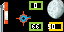
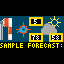
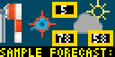

# CycleCast

A little weather wisdom before you turn the pedals.

CycleCast turns your Tidbyt or compatible Tronbyt display into a colorful, animated weather companion for cyclists—and anyone who enjoys getting outside.

A fluttering windsock brings the breeze to life, a directional arrow helps you size up the wind, and compact color-coded boxes put UV, temperature, and humidity within an easy glance. Sunshine, moon phases, clouds, and rain add a little atmosphere to the picture.

Whether you’re considering a quick spin, a longer adventure, or simply a walk around the neighborhood, CycleCast helps you start with a better sense of the conditions.

Less time opening weather apps. More inspiration to get moving.

## Display Previews

### Standard Display — 64 × 32

A compact weather dashboard for standard-resolution displays, combining animated wind graphics, weather icons, and three easy-to-spot information boxes.

### Square Display — 64 × 64

The square version centers the compact 64 × 32 dashboard within the taller canvas rather than stretching the artwork vertically.

### Wide 2× Display — 128 × 64

A bigger dashboard for your next outdoor adventure. The wide 2× version doubles the compact layout’s dimensions, with larger weather icons, animated wind graphics, and information boxes.

This preview uses Sample Mode to demonstrate the layout—not actual local weather.

## Features

- Hourly weather forecasts — Uses Open-Meteo forecast data for your selected location.
- Animated windsock — Varies its appearance between sustained-wind and gust categories.
- Animated wind-direction arrow — Flutters around the reported wind’s source direction.
- Color-coded information boxes — Displays UV index, temperature, and relative humidity.
- Optional scrolling details — Adds forecast time, feels-like temperature, precipitation information, wind, gusts, and more.
- Day and night presentation — Shows a daytime scene or a moon icon appropriate to the calculated phase.
- Cloud and rain icons — Adds visual cues based on the selected hourly forecast values.
- Hourly refresh target — Reuses cached forecast data between normal refresh attempts.
- Labeled fallback data — Can temporarily use a recent cached forecast if a refresh fails.
- Sample Mode — Displays consistent example weather without weather API calls.
- Adjustable playback — Choose slow, medium, or fast animation and scrolling.
- Optional error hiding — Hide the app when no usable recent forecast is available.
- On-device instructions — Show scrolling setup and interpretation notes.

## Reading the Dashboard

### Windsock: Wind and Gusts

The animated windsock changes between categories derived from the forecast sustained wind and gust speed.

A more extended windsock represents a higher wind-speed category. Its changing appearance adds a visual sense of gustiness.

This is an illustration of forecast values—not a live measurement from a local windsock or sensor.

### Direction Arrow: Where the Wind Comes From

The windrose and animated arrow provide a directional cue for the wind’s reported source direction.

The information bar also spells it out, such as:

> Wind from NE at 9.0 mph; gusts 18.0 mph.

Use the written “Wind from” detail when you want an unambiguous description.

The arrow is omitted when the reported sustained wind speed is zero.

### Three Boxes: UV, Temperature, and Humidity

| Position | Value |
| --- | --- |
| Upper box | UV index |
| Lower middle box | Temperature in degrees Fahrenheit |
| Lower right box | Relative humidity as a percentage |

The displayed box values are rounded. The scrolling details can provide additional precision.

Each box has its own color scale. The colors are separate visual indicators, not a combined score or a guarantee that conditions are suitable for riding.

Missing optional values appear as `--` in the boxes.

### Sky Icons: A Little Context

The scene uses:

- A sun icon during daytime.
- A moon-phase icon at night.
- A rain icon when the hourly precipitation value is greater than zero.
- Otherwise, a cloud icon when forecast cloud cover exceeds 15%.

The rain cue follows the selected hourly precipitation amount—not precipitation probability alone. It should not be read as a live rain detector.

## Turn On the Details

Enable “Information Bar” for a scrolling explanation of the selected forecast hour.

The text includes:

- Forecast-hour label
- Temperature
- Feels-like temperature
- Cloud cover
- Relative humidity
- Precipitation probability
- Preceding-hour precipitation amount
- UV index and category
- Wind source direction
- Sustained wind speed
- Gust speed
- Open-Meteo attribution

Unavailable optional values are labeled rather than silently replaced with zero.

The information bar is automatically shown for sample weather and cached fallback data, even if you normally leave it disabled.

