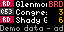

# DC Metro Arrivals

Live Metrorail and Metrobus arrivals for Tidbyt / Tronbyt, straight from WMATA's API, merged into one list sorted by time.

## Setup

1. Get a free API key: sign up at [developer.wmata.com](https://developer.wmata.com), open **Products → Default Tier**, subscribe, and copy the primary key from your profile.
2. Paste it into **WMATA API key**. Without a key the app shows demo data.
3. Pick a **Metro station** and/or enter up to three **Bus stop IDs** (the 7-digit number on the stop sign, or click a stop at [buseta.wmata.com](https://buseta.wmata.com)).

## Options

| Setting | What it does |
| --- | --- |
| Line | Only trains on one line. |
| Only trains to | Comma-separated partial destination names, e.g. `Glenmont, Silver Spr`, to see one direction. |
| Only these bus routes | Comma-separated route names as shown on the bus (Better Bus names, e.g. `C53, D10`). |
| Walk time | Hides trains/buses arriving sooner than you could reach them. Separate settings for station and bus stop. |

Transfer stations (Metro Center, Gallery Place, L'Enfant Plaza, Fort Totten) include every platform.

## Display

- Rail rows: line-colored badge, destination, minutes (`BRD` boarding, `ARR` arriving).
- Bus rows: route badge, destination, minutes (`NOW` when due).
- 64×32 shows 4 rows, 128×64 shows 4 larger rows, 64×64 shows 8.

## API usage

Each refresh makes one rail request plus one per bus stop, cached for 30 seconds. WMATA's free tier allows 50,000 calls a day, which is far more than one display needs.
