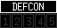
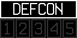
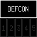

# DefCon

A little command-center atmosphere for your corner of the world.

DefCon brings a WarGames-inspired readiness display to your Tidbyt or compatible Tronbyt device. A bold heading, five numbered indicators, and a colorful countdown animation give your desk a little classic control-room drama.

Choose an automatic estimate from DefConLevel.com, or manually select a level for your own display. Keep the animation for the full cinematic effect—or switch to a steady, understated indicator.

Small screen. Serious retro atmosphere.

## Important: This Is Not an Official Military Status Display

Automatic mode shows an unofficial estimate published by DefConLevel.com.

It does not retrieve or verify an official U.S. military DEFCON level. Manual mode simply displays the number you select.

Treat this app as an informational and decorative display—not an emergency warning system or a basis for safety decisions.

## Display Previews

The layout adapts its heading and indicator boxes to the available canvas.

### Standard Display — 64 × 32

The compact command-center look: a framed DEFCON heading above five numbered indicators.

### Wide 2× Display — 128 × 64

The higher-resolution wide presentation uses larger fonts and thicker borders for a bolder control-room dashboard.

### Square Display — 64 × 64

The square layout uses the taller canvas for the heading and indicator row, with more vertical room than the standard format.

## Features

- WarGames-inspired styling — A miniature tribute to the classic movie’s DEFCON display.
- Automatic website estimate — Retrieves the level displayed by DefConLevel.com.
- Manual selection — Choose any level from 1 through 5 without retrieving the website estimate.
- Countdown animation — Highlights levels from 5 down to the selected number.
- Blinking emphasis — Blinks the selected level three times before holding it.
- Static display option — Keeps the selected indicator steadily highlighted.
- Distinct level colors — White, red, yellow, green, and blue identify the five levels.
- Twelve-hour HTTP caching — Automatic mode requests a cached website response to reduce repeated fetching.
- On-device instructions — Explains the source, limitations, and display behavior.
- No personal API key — Automatic mode reads a public webpage rather than requiring your own API credentials.

## Choose Your Mode

### Automatic — Website Estimate

Automatic mode is the default.

The app requests the current-level page from DefConLevel.com, reads its displayed numeric badge, and highlights the corresponding indicator.

[View the source page on DefConLevel.com](https://www.defconlevel.com/current-level)

This is the website’s assessment—not an official military feed.

The HTTP response is cached for 12 hours, so a new app render does not necessarily retrieve a newly published value.

### Manual Level

Select a number from 1 through 5 to display that level directly.

Manual mode does not fetch the website estimate. It is useful for:

- A themed desk or movie corner
- Demonstrating the animation
- Generating consistent previews
- A personal, purely decorative status display

A manually selected level says nothing about actual world events or military readiness.

## Reading the Display

The indicator row runs from 1 on the left to 5 on the right.

The selected number appears in its assigned color. Other indicators remain dim gray.

| Level | Indicator color | Label used in the app |
| --- | --- | --- |
| 5 | Blue | Normal Readiness |
| 4 | Green | Above Normal Readiness |
| 3 | Yellow | High Caution |
| 2 | Red | Risk of Impending Attack |
| 1 | White | Maximum Readiness |

These are the app’s selection labels, not independently verified descriptions of a current military condition.

The scale runs downward: 5 represents the lowest alert level, while 1 represents the highest.

## The Countdown Effect

With “Animate Display” enabled, the sequence:

1. Begins with all five indicators dimmed.
2. Highlights level 5.
3. Steps downward until it reaches the selected level.
4. Blinks the selected indicator three times.
5. Holds the selected indicator before the animation repeats.

For example, selecting level 3 produces a highlighted sequence of:

> 5 → 4 → 3

Only one level is highlighted at a time.

This sequence is a visual effect. It does not mean the source has reported a progression through those levels or that the status is changing in real time.

Prefer a quieter presentation? Disable “Animate Display” to keep the selected level steadily lit.

## Get Started

1. Add DefCon to your display.
2. Open the app’s settings.
3. Leave “DEFCON Level” on “Automatic - Website Estimate,” or choose a manual level.
4. Enable or disable “Animate Display” to suit your style.
5. Save your settings.

For an explanation on the device itself, enable “Display Instructions.” Turn it off to return to the indicator display.

Automatic mode requires network access. Manual mode does not make the website request.

## Available Settings

| Setting | What it does |
| --- | --- |
| DEFCON Level | Uses the website estimate or displays a manually selected level from 1 through 5. Defaults to Automatic. |
| Animate Display | Enables the countdown and blinking effect. Enabled by default. |
| Display Instructions | Shows scrolling information about the source and display instead of the indicators. |

## Updates and Source Availability

Automatic mode depends on a public webpage and its HTML structure.

The current app looks for a numeric badge matching a level from 1 through 5. If the request fails, the badge cannot be found, or its text is invalid, the app reports a render error.

It does not silently substitute a manual level or a supposedly “safe” default when automatic retrieval fails.

Keep in mind:

- The website response can remain cached for up to 12 hours under normal cache behavior.
- Frequent display refreshes do not guarantee fresher source information.
- A source-site redesign can require an app update.
- Replaying an existing rendered image does not perform another lookup.
- There is no built-in notification when the website’s estimate changes.

## Notes

- This app is not affiliated with the U.S. military or an official warning service.
- Automatic mode displays an unofficial third-party estimate.
- Manual mode displays a user-selected value.
- The countdown and blinking are decorative animations, not evidence of a changing alert condition.
- No news analysis or independent threat assessment is performed by the app.
- Use authoritative public alerts and official guidance for emergency information.

---

A tiny control room. A classic cinematic touch.

Created by Robert Ison.
