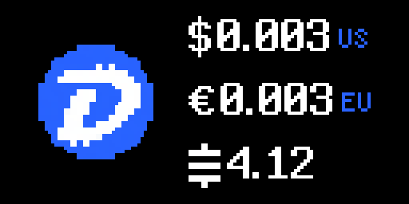

# DigiByte Price

Displays the current [DigiByte](https://digibyte.org/) price on your Tronbyt in up to four currencies (AUD, CAD, EUR, GBP, USD and SATS). Data provided by [CoinGecko](https://www.coingecko.com/). Updated every 10 minutes. No API key required. Uses the [Satoshi Symbol](https://satsymbol.com/).

Works on 64x32, 64x64 and 128x64 displays.

If CoinGecko can't be reached, the app keeps showing the last prices it fetched. Once they are more than 30 minutes old, they turn amber so you know they may be out of date.

## Run a DigiByte node

Want to do more than watch the price? [DigiNode Tools](https://diginode.tools) makes it easy to run your own DigiByte full node on a Raspberry Pi or Linux server, helping to support the DigiByte network 24/7. A menu-driven setup means you need almost no Linux command line experience, and the DigiNode Dashboard lets you keep an eye on your node's status and your hardware.

## About

This app is maintained by [DigiNode Tools](https://diginode.tools). Find out more on [GitHub](https://github.com/DigiNode-Tools/diginode-tools).

