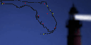
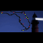

# Florida Lighthouses

A little coastal charm. A map full of memories. Another beacon to discover.

Florida Lighthouses turns your Tidbyt or compatible Tronbyt display into a colorful tribute to the Sunshine State’s coastal landmarks.

Explore a compact map of Florida, highlight the lighthouses you’ve visited, and watch your personal collection of coastal adventures grow. An optional animated lighthouse background adds a little seaside atmosphere, while city markers help put the locations in context.

Whether you’re remembering a favorite stop or dreaming up your next coastal road trip, it’s a small display with plenty of Florida spirit.

## Display Previews

Florida Lighthouses includes presentations for standard, wide 2×, and square displays.

### Standard Display — 64 × 32

A compact Florida map with lighthouse markers, optional city locations, and an animated lighthouse backdrop.

### Wide 2× Display — 128 × 64

The wide version uses a larger plotted map, a dedicated higher-resolution lighthouse animation, and a larger font for the optional visited count.

### Square Display — 64 × 64

The square presentation centers the compact 64 × 32 scene within the taller canvas, keeping the original arrangement without stretching it vertically.

## Features

- Florida map outline — See lighthouse locations in their geographic context.
- Personal visit tracking — Mark individual lighthouses using an alphabetical checklist.
- Visited-location highlighting — Give your selected destinations a distinct color.
- Visited-only view — Hide unvisited lighthouse markers when highlighting is enabled.
- Optional progress count — Display visited entries as a fraction of the app’s total collection.
- Animated lighthouse artwork — Add a little coastal atmosphere behind the map.
- Optional major cities — Show city markers to help orient yourself.
- Custom marker colors — Choose separate colors for visited lighthouses, unvisited lighthouses, and major cities.
- Automatic outline contrast — Uses a subdued outline with artwork and a bright outline without it.
- Bundled map and location data — No external location feed or personal API key is required.

## Make It Your Coastal Collection

Turn on “Highlight Visited Lighthouses” to reveal the lighthouse checklist.

Mark the locations you’ve visited, and their map markers appear in your chosen visited color. It’s a simple way to turn a map into a personal record of discovery.

Use it to remember:

- A favorite coastal road trip
- A memorable climb to a lantern room
- A stop that became the highlight of a vacation
- The lighthouse you finally crossed off your list

Visits are recorded manually. The app doesn’t track your location or automatically detect where you’ve been.

## Choose Your View

### The Full Collection

Leave “Hide Unvisited Lighthouses” off to show the app’s lighthouse collection.

With visited highlighting enabled, selected destinations appear in the visited color while the remaining markers retain the unvisited color.

This gives you a map of both memories and possibilities.

### Just the Places You’ve Been

Enable both:

- “Highlight Visited Lighthouses”
- “Hide Unvisited Lighthouses”

Only your selected lighthouse markers remain visible.

The map outline, optional artwork, and optional city markers are controlled separately.

“Hide Unvisited Lighthouses” has no effect when visited highlighting is disabled, avoiding an unexpectedly empty lighthouse layer.

## Watch Your Progress Grow

Enable “Show Visited Count” to display:

> visited / total

The count uses the number of lighthouse entries you’ve selected—not the number of visible dots.

That distinction matters on a small display: nearby lighthouses can project onto the same pixel, but each selected entry still contributes to your total.

The counter uses your visited-marker color and continues to reflect saved selections even when visited highlighting is temporarily turned off.

## A Little Lighthouse Atmosphere

“Show Background Artwork” adds the bundled animated lighthouse scene.

With the artwork enabled, the Florida outline becomes dark and subtle so the background and location markers can share the scene.

Turn the artwork off for a brighter white outline and a simpler map-focused presentation.

The wide 2× version uses its own higher-resolution animation asset rather than relying solely on enlarging the standard artwork.

## Add Some Geographic Context

Enable “Show Major Cities” to add the city locations included in the app’s dataset.

These markers provide reference points for the lighthouse map. They are visual markers, not a labeled city guide or a source of driving directions.

The default city color is red, and you can change it independently of the lighthouse colors.

## Make the Colors Your Own

| Element | Default color |
| --- | --- |
| Visited lighthouses | Bright yellow |
| Unvisited lighthouses | Muted yellow-green |
| Major cities | Red |
| Map outline with artwork | Very dark gray |
| Map outline without artwork | White |

Visited, unvisited, and city marker colors are adjustable.

The optional visited count follows the visited-lighthouse color. Outline colors are selected automatically based on whether background artwork is enabled.

## Get Started

No accounts, API keys, or external data feeds are required.

1. Add Florida Lighthouses to your display.
2. Open the app’s settings.
3. Decide whether to show the animated background.
4. Enable “Highlight Visited Lighthouses.”
5. Mark your visited locations in the generated checklist.
6. Enable “Show Visited Count” if you’d like a progress tally.
7. Add major cities or hide unvisited markers to suit your preferred view.
8. Choose your marker colors and save your settings.

## Available Settings

| Setting | What it does |
| --- | --- |
| Show Background Artwork | Displays the animated lighthouse background. Enabled by default. |
| Show Major Cities | Adds the included major-city markers. Disabled by default. |
| Highlight Visited Lighthouses | Reveals the checklist and highlights selected lighthouse locations. |
| Lighthouse checklist | Records which lighthouse entries you’ve visited. |
| Hide Unvisited Lighthouses | Shows only visited lighthouse markers when highlighting is enabled. |
| Show Visited Count | Displays selected lighthouse entries divided by the collection total. |
| Visited Lighthouse Color | Sets visited-marker and counter color. |
| Unvisited Lighthouse Color | Sets unvisited-marker color. |
| Major City Color | Sets city-marker color. |

## Why Some Locations Share a Dot

Florida’s coastline has to fit into a very small canvas.

When geographic coordinates are converted to pixels, nearby locations can land on the same point. A selected lighthouse still highlights that shared pixel, even if another lighthouse at the same pixel is unvisited.

The map is therefore a compact visualization—not a one-dot-per-building inventory.

The progress counter keeps track of entries separately, so overlapping markers don’t reduce your recorded total.

## Notes

- The app uses its bundled lighthouse collection; do not assume it includes every historic or current Florida lighthouse.
- Visits are recorded manually in settings.
- Locations and artwork are bundled with the app, not retrieved from a live service.
- The map does not provide opening hours, admission information, access restrictions, or current site conditions.
- A location’s appearance in the collection does not guarantee public access.
- Check current visitor information before planning a trip.
- Use the display for inspiration and personal tracking, not navigation.

---

Keep your coastal memories glowing.

Created by Robert Ison.
