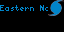
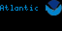
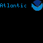

# HurricaneTracker

A small display with a wider view of the tropics.

HurricaneTracker brings National Hurricane Center feed information to your Tidbyt or compatible Tronbyt display in a compact, scrolling dashboard.

Choose a basin, set your location, and see the nearest tracked tropical system alongside its reported winds, pressure, movement, and headline. A rotating storm icon adds visual character, while local publication times and optional update-age labels help you understand how recent the information is.

It’s a convenient way to keep tropical activity in view—without keeping a weather page open all day.

## Important: Awareness, Not an Emergency Warning System

HurricaneTracker is a supplementary information display.

It does not determine your local risk, issue evacuation guidance, or replace official forecasts, watches, warnings, and emergency instructions.

The nearest storm center is not necessarily the system posing the greatest threat to you. Always consult official information when making safety decisions.

## Display Previews

### Standard Display — 64 × 32

A compact tropical-weather dashboard with scrolling storm details and an icon for the nearest tracked system.



### Wide 2× Display — 128 × 64

The wide 2× presentation uses a larger text font and the wider canvas for scrolling information. The storm icon retains its fixed 16 × 16 dimensions.



### Square Display — 64 × 64

The square presentation uses the standard text size on a taller canvas. It retains the stacked information layout rather than enlarging the artwork to fill the panel.



## Features

- National Hurricane Center feeds — Reads tropical-system information from the selected basin’s RSS feed.
- Three basin choices — Monitor the Atlantic, Eastern Pacific, or Central Pacific.
- Nearest-system selection — Compares reported storm-center positions with your selected location.
- Distance and direction — Shows approximate miles and compass direction from you to the storm center.
- Core storm details — Displays reported winds, pressure, movement, and headline.
- Other-system summaries — Optionally appends additional tracked systems in distance order.
- Local publication time — Displays the selected feed item’s publication time in your location’s time zone.
- Optional update age — Adds a readable elapsed-time label.
- Old-update indication — Marks older information with an orange header and “OLD UPDATE.”
- Rotating storm icons — Animates hurricane and tropical-storm icons.
- Independent animation controls — Choose text scrolling and approximate icon rotation speed separately.
- Quiet-period hiding — Optionally skips the app when no tracked cyclone entries are present.
- Clearly labeled sample mode — Demonstrates the display without requesting the live feed.
- On-device instructions — Explains the main display cues and limitations.

## Choose Your Basin

| Setting | Feed monitored |
| --- | --- |
| Atlantic Basin | NHC Atlantic feed |
| Eastern Pacific Basin | NHC Eastern North Pacific feed |
| Central Pacific Basin | NHC Central North Pacific feed |

The default is Atlantic.

Each app instance monitors one selected basin. The nearest-system calculation compares systems within that basin—not across all three feeds.

## Set Your Location

Your selected location is used to calculate:

- Approximate straight-line distance to each storm center
- Compass direction from you to that center
- Which tracked system is nearest
- Local display time for the selected feed item’s publication

Set your own location before relying on those distance labels. The code’s default location is Orlando, Florida.

The app does not calculate a forecast track toward your location or estimate when a storm might arrive.

## Reading the Display

### Header: Basin and Update Time

The first row identifies the basin and shows the selected system’s feed-item publication time.

When “Show Update Age” is enabled, it also includes an elapsed-time description, such as:

> Updated: … | 2h 15m ago

The time shown is the source item’s publication time—not simply the last time your display refreshed.

### White Text: Nearest-System Details

The next row combines:

- System type and name
- Approximate distance in miles
- Direction from your location to the storm center
- Reported winds
- Reported pressure
- Reported movement

For example, “Northeast of you” describes where the center is relative to your location. It does not mean the storm is moving northeast or heading toward you.

Movement is shown separately using the feed’s supplied text.

Missing detail fields are labeled “unavailable.”

### Yellow Text: Headline and Other Systems

The final row shows the nearest system’s supplied headline.

When “Show Other Tracked Systems” is enabled, summaries of additional systems follow, nearest first. These include each system’s label, reported winds, and distance.

This setting adds summaries; it does not rotate the full dashboard through every storm.

## Storm Icons

The icon follows the nearest system’s reported type:

| Reported type | Icon behavior |
| --- | --- |
| Hurricane | Rotating hurricane icon |
| Tropical storm | Rotating tropical-storm icon |
| Other supported feed types | Static NHC icon |

Rotation is a visual effect, not a measurement of the storm’s actual rotation rate or intensity.

### Choose a Rotation Speed

| Setting | Approximate revolution time |
| --- | --- |
| Slow | 10 seconds |
| Medium | 6 seconds |
| Fast | 4 seconds |

The app compensates for the selected text frame delay so that changing scrolling speed does not intentionally change the icon’s revolution time.

## Understanding “OLD UPDATE”

The “Old Update Threshold” checks how long ago the selected system’s feed item was published.

Choose:

- 6 hours
- 12 hours
- 24 hours
- Disable old-update label

The default is 12 hours.

When the threshold is reached:

- “OLD UPDATE” is added to the header.
- The header changes from blue to orange.

Orange means older information—not increased storm danger.

The label does not hide the data, issue an alert, or determine whether the source should have published a newer advisory.

If a publication time is unavailable, the app says “Update time unavailable” rather than assigning an age.

## What the App Tracks—and What It Doesn’t

HurricaneTracker reads structured cyclone entries from the selected feed.

It does not display developing disturbances that appear only in tropical weather outlook products.

That distinction matters: a basin can have areas under investigation or development potential even when this app has no tracked systems to show.

A quiet or hidden app does not mean there are no tropical-weather concerns.

### How the Nearest System Is Chosen

The app:

1. Finds feed items containing structured cyclone data.
2. Requires a system name and usable center coordinates.
3. Deduplicates entries using the supplied storm identifier when available.
4. Calculates distance from your selected location.
5. Sorts the usable systems by distance.

The nearest usable system becomes the featured system.

Selection is based on distance to the center—not intensity, forecast impacts, watches, warnings, or expected landfall.

## Get Started

No personal API key or subscription is required by the app.

1. Add HurricaneTracker to your display.
2. Open the app’s settings.
3. Set your location.
4. Choose a hurricane basin.
5. Select text scrolling and storm rotation speeds.
6. Decide whether to show update age and other-system summaries.
7. Choose an old-update threshold.
8. Leave “Show Sample Data” off for live feed information.
9. Save your settings.

Enable “Show Instructions” for scrolling help, then turn it off to return to tracking.

## Sample Mode and Preview Images

Enable “Show Sample Data” to use the bundled historical-style test feed instead of requesting a live basin feed.

The display is labeled “SAMPLE.”

Sample publication dates are intentionally exempt from old-update warnings and large elapsed-age labels. They are demonstration data, not current storm reports.

Sample Mode is useful for checking the layout or generating previews when no live systems are available.

From your `apps` folder, render sample previews with:

```bash
pixlet render hurricanetracker/hurricanetracker.star sample_mode=true -o hurricanetracker/hurricanetracker.webp
pixlet render -2 hurricanetracker/hurricanetracker.star sample_mode=true -o hurricanetracker/hurricanetracker@2x.webp
pixlet render --width 64 --height 64 hurricanetracker/hurricanetracker.star sample_mode=true -o hurricanetracker/hurricanetracker@64x64.webp
