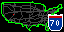
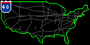
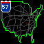

# Interstates

A little road-trip spirit, one highway at a time.

Interstates turns your Tidbyt or compatible Tronbyt display into a miniature celebration of the American highway network.

Watch a selected route draw itself across a map of the contiguous United States, accompanied by a classic red, white, and blue Interstate shield. Highlight a familiar highway, discover a different route with each render, or put the surrounding network in view for a little geographic perspective.

Whether a route brings back vacation memories or sparks ideas for the next long drive, Interstates puts a small piece of the open road on your desk.

No fuel stops required.

## Display Previews

Interstates uses the available canvas dimensions to draw its map and routes.

### Standard Display — 64 × 32

A compact cross-country view, with an animated route and an optional Interstate shield tucked into a corner.

### Wide 2× Display — 128 × 64

The wider, higher-resolution canvas gives the map and highway paths more room. The shield retains its compact 15 × 17 pixel dimensions.

### Square Display — 64 × 64

The square version uses the taller canvas for the map and route animation.

The current layout scales longitude and latitude independently to the available dimensions, so the map appears taller than it does on the wide displays rather than preserving a fixed geographic aspect ratio.

## Features

- Animated route drawing — Watch the selected highway appear progressively across the map.
- Choose a specific Interstate — Keep a favorite route in the spotlight.
- Random route selection — Let the app choose from routes with usable geometry whenever it renders.
- Two display modes — Show a single route or highlight one against the surrounding highway network.
- Classic Interstate shield — Displays the selected route number in a hand-built red, white, and blue sign.
- Adaptive shield placement — Chooses a corner that minimizes overlap with the selected route.
- Custom map and route colors — Set separate colors for the map outline, featured highway, and background highways.
- A finishing pause — Holds the completed route before the animation repeats.
- Bundled geographic data — No API keys, subscriptions, or external traffic feeds are required.
- Canvas-aware rendering — Fits the map to standard, wide, and square display dimensions.

## Choose Your View

### Single Highway

Keep the presentation simple.

This mode displays the map outline and the selected Interstate, making it easier to follow that route without the surrounding network competing for attention.

It’s a natural choice for a favorite highway or a route with a personal connection.

### Highlight One but Show All

Put the featured route in context.

Other valid Interstate routes in the bundled dataset appear in the background color, while the selected route draws itself in the highlight color.

The result is a miniature network map with one highway taking center stage.

This is the default display mode.

## Pick a Favorite—or Take the Scenic Route

The “Interstate” setting offers:

- Random selection
- Individual routes from the included dataset

Routes in the menu are sorted numerically.

Choose a specific Interstate to feature it on each render, or select “Random” to let the app choose a usable route.

Random selections can repeat. Replaying an existing animation repeats the same highway; a new selection happens when the app renders again.

If a configured route is missing or has no usable geometry, the code falls back to a random usable route.

## Watch the Highway Take Shape

The selected route is converted into screen pixels, then revealed progressively.

The animation:

1. Draws the route over 40 frames.
2. Holds the completed route for 30 frames.
3. Repeats when the animation loops.

At the configured 100-millisecond frame delay, that is approximately four seconds of drawing followed by three seconds of holding.

The reveal follows the order of the bundled route geometry. It is a visual effect—not a vehicle moving along the highway or a simulation of travel time.

The number of drawing frames stays fixed, so longer or more detailed routes can reveal more pixels per frame.

## A Shield with a Sense of Place

Enable “Show Sign” to display the selected highway’s number inside a compact Interstate-style shield.

The app evaluates four corner positions and favors the one covering the fewest selected-route pixels. Route-specific corner preferences break ties.

This helps keep the highlighted highway visible, but it cannot guarantee that the sign will avoid every map feature or background highway.

The shield uses a smaller number font for three-digit routes.

## Make the Map Your Own

Three independent color settings let you shape the presentation.

| Element | Default color |
| --- | --- |
| Map outline | Green |
| Selected highway | Red |
| Other highways | Dark gray |

Try a subdued outline with a bright featured route, or choose a palette that matches your display’s surroundings.

“Other Highways” affects the background network only when the display mode includes it.

The shield retains its red, white, and blue styling.

## Get Started

No accounts, API keys, or external data feeds are required.

1. Add Interstates to your display.
2. Open the app’s settings.
3. Choose a “Display Mode.”
4. Select a specific “Interstate,” or leave it on “Random.”
5. Decide whether to show the route shield.
6. Choose your map, highlight, and background-highway colors.
7. Save your settings and enjoy the journey.

## Available Settings

| Setting | What it does |
| --- | --- |
| Display Mode | Chooses “Single Highway” or “Highlight one but show all.” Defaults to the full-network view. |
| Interstate | Selects a particular route or a random usable route on each render. Defaults to Random. |
| Show Sign | Displays the selected route’s shield in a corner chosen to minimize route overlap. Enabled by default. |
| Map Color | Sets the outline color. Defaults to green. |
| Highlight Color | Sets the selected route’s color. Defaults to red. |
| Other Highways | Sets the background-network color. Defaults to dark gray. |

## What’s Included

The app reads highway paths from its bundled `highways.star` dataset and the map outline from `usa_map_data.star`.

The map uses the largest outline ring from the supplied map geometry as its mainland reference.

Available highway choices come from dataset names that match the app’s Interstate-number format and have usable route coordinates.

The collection is a visual dataset, not a guarantee that every Interstate, current extension, or recently changed alignment is included.

## Notes

- This is a geographic visualization, not a navigation or traffic app.
- It does not show congestion, closures, construction, weather, or travel times.
- The map does not include separate Alaska or Hawaii insets.
- Fine route details can merge or disappear at small display resolutions.
- Longitude and latitude are scaled independently to fit the canvas.
- The square layout therefore changes the map’s proportions relative to a wide display.
- The shield remains 15 × 17 pixels on larger canvases rather than automatically doubling in size.
- Random mode can select the same route on consecutive renders.
- Animation timing and shield styling are currently defined in code rather than exposed as settings.

---

A small map. A familiar shield. A little open-road possibility.

Created by Robert Ison.
