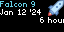
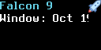
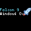

# LaunchCountdown

A little mission-control excitement, right on your desk.

LaunchCountdown brings the anticipation of an upcoming rocket launch to your Tidbyt or compatible Tronbyt display.

See the vehicle, scheduled local time, time remaining, launch-site details, and mission description alongside an animated rocket. Follow the next available launch, narrow the selection to favorite providers or launch-site countries, or let the app appear only when a launch is getting close.

Whether you’re a dedicated launch watcher or simply love knowing what’s heading skyward next, it’s a small window into some very big departures.

## Display Previews

### Standard Display — 64 × 32

A compact launch dashboard with four information rows, scrolling details, and an animated rocket beside the upper rows.

### Wide 2× Display — 128 × 64

The higher-resolution wide version uses a larger text font and more horizontal room for launch information.

The rocket artwork retains its native dimensions rather than automatically doubling in size.

### Square Display — 64 × 64

The square version centers the launch-information layout within the taller canvas, retaining the compact text and artwork.

## Features

- Upcoming launch information — Uses RocketLaunch.live’s next-five-launches feed.
- Local launch times — Converts the structured launch time or window-opening time to your selected location’s time zone.
- Time remaining — Displays a compact countdown calculated when the app renders.
- Launch-window awareness — Distinguishes a scheduled launch time from a window-opening time.
- Estimated-date support — Can display launches without an exact time as “Time TBD.”
- Provider filters — Follow one or more providers by name.
- Launch-site country filters — Limit matches to selected launch-site countries.
- Adjustable notice period — Show timed launches only when they fall within your chosen interval.
- Animated rocket artwork — Adds a little launch-day personality.
- Scrolling mission details — Shows available provider, pad, location, and descriptive information.
- Optional empty-result hiding — Skip the app when no launch qualifies.
- Separate error-display control — Decide whether handled feed errors should appear on the device.
- Five-minute HTTP caching — Reuses the feed response between normal refreshes.
- On-device instructions — Provides a scrolling setup refresher.

## Important: The Feed Contains the Next Five Launches

The app requests the next five worldwide launches supplied by RocketLaunch.live.

Provider, country, and notice-period filters are applied to that returned list.

This means:

- A provider may have upcoming launches that are not yet among those five.
- A country filter does not request a separate country-specific schedule.
- “No matching launch” does not mean that provider or country has no future launches.
- An “Always Display” setting cannot reveal launches absent from the returned feed.

Think of the filters as narrowing a small upcoming-launch list—not searching a complete launch calendar.

## Reading the Display

### First Row: Vehicle

The upper row shows the launch vehicle’s name.

If the feed does not provide a vehicle name, the app uses “Rocket launch.”

### Second Row: Local Date and Time

For a timed entry, the app displays the local date, year, clock time, and time-zone abbreviation.

If the feed supplies a window-opening time instead of a scheduled launch time, the row begins with:

> Window:

If neither time is available, the app uses the supplied estimated date and adds:

> Time TBD

### Third Row: Countdown and Launch Location

The next row shows the time remaining and available location information.

Depending on the source fields, this can include:

- Launch provider
- Launch pad
- Launch-site location
- State
- Country

Duplicate text values are removed from the assembled location details.

### Fourth Row: Mission Information

The final row shows the mission name and available launch description.

Long rows scroll, with staggered starting offsets to make the information easier to follow.

## Scheduled Time vs. Launch Window

The app checks for timing information in this order:

1. Scheduled launch time (`t0`)
2. Window-opening time (`win_open`)
3. Estimated date, without an exact countdown

When a scheduled launch time is available, the status reads:

> Launch in …

When only a window-opening time is available, it reads:

> Window opens in …

A window-opening countdown is not a promise that the rocket will launch at that instant.

## What Happens When the Time Passes?

Passing the scheduled time does not prove that a launch occurred.

For up to 15 minutes after the selected time, the app can retain the entry and show a status such as:

> Scheduled time passed … Awaiting schedule update

For a window-opening time, it instead reports that the window opened and that a launch update is awaited.

Once the time is more than 15 minutes in the past, that entry is no longer eligible for selection.

This is a short scheduling grace period—not launch confirmation or a complete tracker for an ongoing launch window.

## Choose When the App Appears

The “Notice Period” setting controls how far ahead a timed launch can be before it qualifies.

Available choices include:

- 1 through 6 hours
- 12 hours
- 1, 2, or 3 days
- 1 week
- Always display next matching launch if known

For example, choose two hours to show a qualifying timed launch only when its scheduled launch time or window-opening time is within two hours.

### Always Display

This is the default.

It allows eligible timed entries regardless of how far ahead they are, and also admits entries that have only estimated dates.

A finite notice period excludes entries with no usable exact time because the app cannot calculate whether they fall inside that period.

Selection preserves the feed’s ordering. In Always Display mode, an estimated-date entry earlier in the feed can therefore appear before a later entry with an exact time.

## Filter by Provider

Use “Only Show These Providers” to enter one or more exact provider names.

For example:

    SpaceX

For multiple providers, separate their names with commas.

Matching:

- Ignores capitalization.
- Removes surrounding spaces from each filter value.
- Requires the complete provider name, not a partial match.

Leave the field blank to allow all providers.

Use the provider name supplied by the feed. A mission customer, rocket name, or abbreviation will not necessarily match the provider field.

## Filter by Launch-Site Country

Use “Only Show These Countries” to enter exact launch-site country names.

For example:

    United States

Separate multiple countries with commas, or leave the field blank to allow all countries.

This filter uses the launch site’s country—not the provider’s headquarters or the mission customer’s nationality.

As with provider filters, matching ignores capitalization but requires the complete name.

### Combining Filters

Within each field, any listed name can match.

When both fields are filled in, a launch must satisfy both:

- One of the allowed providers
- One of the allowed launch-site countries

Remember that all matching is limited to the feed’s next five launches.

## Set Your Time Zone

Choose your location to display structured launch times locally.

The location setting is used for its time zone. It does not:

- Limit launches to nearby sites
- Calculate distance to the launch pad
- Predict whether a launch will be visible from your location

Without a supplied location, the code’s default location is Orlando, Florida.

The dedicated date-and-time row is the clearest local-time reference. The mission description is largely source text; only a specifically matching UTC clock phrase is replaced, so do not assume every time or date mentioned in prose has been fully localized.

## Get Started

No personal API key is required by the current app.

1. Add LaunchCountdown to your display.
2. Open the app’s settings.
3. Choose your location for local-time formatting.
4. Leave provider and country filters blank to begin with.
5. Select a “Notice Period,” or leave it on Always Display.
6. Choose your preferred scrolling speed.
7. Decide whether to hide the app when nothing matches.
8. Save your settings.

Once the basic display works, add provider or country filters if desired.

Enable “Display Instructions” for on-device help, then turn it off to return to launch information.

## Available Settings

| Setting | What it does |
| --- | --- |
| Location | Sets the time zone used for local launch times. |
| Notice Period | Limits eligible timed launches to the selected interval. Always Display also allows estimated dates. |
| Scroll | Sets scrolling and animation speed. Defaults to Slow Scroll. |
| Only Show These Providers | Filters by comma-separated exact provider names. Blank allows all. |
| Only Show These Countries | Filters by comma-separated exact launch-site country names. Blank allows all. |
| Hide When No Matching Launch | Hides empty or unmatched results instead of displaying an explanation. Enabled by default. |
| Display Errors | Shows handled HTTP and feed-structure errors. Disabled by default. |
| Display Instructions | Shows scrolling setup help instead of launch information. |

## Empty Results vs. Feed Errors

These are controlled separately.

### No Matching Launch

If the feed is valid but nothing qualifies, “Hide When No Matching Launch” decides whether the app hides or explains the result.

Possible reasons include:

- No provider or country match among the next five launches
- No eligible launch within the notice period
- Matching entries have only estimated times
- Matching timed entries have passed the grace period

Disable hiding while adjusting filters so you can see these explanations.

### Feed Errors

“Display Errors” controls whether handled problems such as failed HTTP requests or invalid response structure appear on the display.

Detected errors are also printed to Render Debug.

With this option disabled, those handled errors hide the app. Not every possible runtime or parsing failure is guaranteed to become an on-device message.

## Refreshes and Countdown Behavior

The feed request uses a five-minute HTTP cache.

Filters and notice periods are evaluated locally against the returned data; changing them does not request a different provider-specific or country-specific endpoint.

The countdown is calculated when the app renders and becomes part of that rendered animation.

It does not tick down independently every second while the same image replays. Fresh countdown text requires another app render.

Actual freshness depends on:

- How often your hosting system renders the app
- HTTP cache behavior
- Source updates
- Network availability

The app does not maintain a separate last-successful-feed fallback.

## Launch Data

Launch information is provided by RocketLaunch.live.

[Visit RocketLaunch.live](https://www.rocketlaunch.live/)

Schedules can change. Confirm the latest timing and launch status with the provider or official mission coverage before making viewing or travel plans.

## Notes

- The app searches only the next five launches returned by the feed.
- Matching uses feed order rather than independently sorting every entry by timestamp.
- Estimated dates do not support a precise countdown.
- A countdown reaching zero does not confirm liftoff.
- The rocket animation is decorative, not live telemetry.
- This is a launch-information display, not a local launch-visibility predictor.
- Mission descriptions may contain source time references that are not fully localized.
- No push notifications, launch-success confirmation, or automatic livestream playback are provided.

---

Keep the next departure from Earth in view.

Created by Robert Ison.
