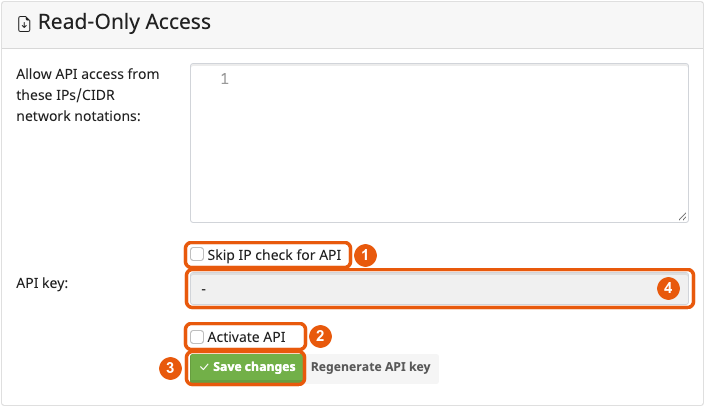

# Mailcow Updates

Shows when there's a new [mailcow](https://mailcow.email) release for your mailcow server, from the version it's running to the latest release on GitHub. mailcow releases often include security fixes, so it's worth updating soon.

You can add up to five mailcow servers. Each server that needs an update gets its own card, showing the server's nickname or domain name, and the cards take turns on the display. On a square display, a card also says when the latest release came out. A card goes once its server is updated. By default the app only appears on your display when there's an update, and skips its turn the rest of the time. Turn off **Only show when there's an update** to also see a screen saying your servers are up to date, so you know it's working. If something's wrong, such as a server it can't connect to or an API key that isn't accepted, it shows a card either way.

## What you need

- A mailcow server reachable over `https://` from your Tronbyt server. On your own network, a `http://` address also works, e.g. `http://192.168.1.50`.
- A **read-only API key** for each mailcow server.

## Creating a read-only API key

In your mailcow admin interface, go to **System > Configuration > Access > Administrators** and find the **API** section. Its layout depends on your mailcow version.

**With a Read-Only Access card** (and a Read-Write Access card beside it):

1. Tick **Skip IP check for API**, or instead enter your Tronbyt server's IP address (see below) in **Allow API access from these IPs/CIDR network notations**.
2. Tick **Activate API**.
3. Click **Save changes**.
4. Copy the key that now shows in **API key**.

**With an API keys list:**

1. Click **Add API key**, and choose **Read-Only Access**.
2. In **Allowed IPs/networks**, enter your Tronbyt server's IP address (see below), or choose to skip the IP check.
3. Save, and copy the API key.

Use read-only access only: the app never changes anything. You don't need to change the CORS settings, because the app's requests come from your Tronbyt server, not a web browser.

Your Tronbyt server's IP address: if it runs at home, this is your home's public IP address (searching for "what is my IP" from your home network shows it). If that address changes from time to time, see [If your home IP address changes](#if-your-home-ip-address-changes).

Then, in the app's settings on your Tronbyt server, choose the **Number of mailcow servers**, and for each one enter:

- **mailcow address**: the address you use for the mailcow web interface, e.g. `https://mail.example.com`.
- **Read-only API key**: the key you copied.
- **Nickname** (only asked for when you have more than one server, optional): shown on the display to tell your servers apart. Leave it empty to show the domain name.

If the app says **API key not accepted**, check that the key is the read-only one, and that your Tronbyt server's current IP address is in its allowed IP addresses (or that **Skip IP check for API** is on).

### If your home IP address changes

Many home internet connections get a new public IP address from time to time. mailcow's allowed list takes IP addresses and ranges, not names, so a fixed address would stop working at the next change, and the app would say **API key not accepted**.

For a home connection like this, turn on **Skip IP check for API** for the app's key, so it works from any address. The key is still protected: mailcow makes it long and random, the app only sends it to your mailcow over `https://`, and it's read-only. What that leaves is the risk of the key itself leaking, for example from a backup of your Tronbyt server; see below.

If you'd rather not skip the check, you can allow your internet provider's address range instead (e.g. `203.0.0.0/16`). That's narrower, but it lets in your provider's other customers, and the range itself can change.

## Keeping your mailcow safe

A read-only key can't change, send or delete anything, but it can read what mailcow's admin API shows: your domains, mailboxes and aliases (their names and settings, not the emails in them), settings, and logs, including the IP addresses people sign in from. Treat it like a password.

- In the app it's stored as a secret on your Tronbyt server, and it's only sent to that mailcow server, never anywhere else.
- The app only uses it to ask mailcow for its version.
- The app won't send it over plain `http://` except to an address on your own network.
- If you think it has leaked, or to stop the app using it, delete the key in mailcow. It stops working straight away.

## How it checks

Your servers' versions are checked about once an hour, and every few minutes while a server is behind, so its card goes soon after you update. New releases are checked on GitHub about once an hour. If a server can't be reached, the app shows **Can't connect** and tries it again 15 minutes later.

A server running something other than a release, such as mailcow's nightly branch, can't be compared with the releases, so it isn't shown as needing an update.

mailcow is a registered word mark of The Infrastructure Company GmbH. The app's pixel-art cow is drawn after the mailcow logo. This app is an independent project, not made or endorsed by the mailcow team.

## Author

Made by [saltedlolly](https://github.com/saltedlolly). You'll find my other projects, including more Tronbyt and Umbrel apps, at [saltedlolly.com](https://saltedlolly.com).

If this app is useful to you, you can support my work by buying me a coffee on [Ko-fi](https://ko-fi.com/saltedlolly) or by [sponsoring me on GitHub](https://github.com/sponsors/saltedlolly). Thank you!
