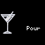

# Martini

Your order. Your style. A little cocktail-hour personality.

Martini turns your Tidbyt or compatible Tronbyt display into a miniature expression of your favorite drink.

Choose your base, vermouth preference, preparation, and garnish, then watch a friendly ordering phrase scroll across matching cocktail artwork. Keep it classic, make it a Gibson, or give a Vesper its moment in the spotlight.

It’s a little conversation piece for your desk, home bar, or favorite corner—no mixing tin required.

## Display Previews

These previews use gin, wet vermouth, stirred preparation, and a lemon twist, with Old School wording enabled.

The resulting order is:

> A wet martini, stirred, with a twist.

The introductory phrase is selected randomly, so it can differ between renders.

### Standard Display — 64 × 32

The classic compact presentation: cocktail artwork with your personalized order scrolling across the lower portion.

### Wide 2× Display — 128 × 64

The wide 2× version doubles the artwork dimensions, text-region placement, and marquee width, with a larger font for the scrolling order.

### Square Display — 64 × 64

The square version centers the compact 64 × 32 composition within the taller canvas rather than stretching it vertically.

## Features

- Personalized order text — Build an order from your preferred base, vermouth, preparation, and garnish.
- Three base choices — Select gin, vodka, or a Vesper.
- Seven vermouth preferences — Choose naked, extra dry, dry, wet, sweet, perfect, or white.
- Five preparation choices — Select shaken, stirred, up, thrown, or on the rocks.
- Garnish-aware artwork — Uses lemon, orange, olive, onion, or ungarnished-glass artwork.
- Gibson naming — Gin or vodka orders with a cocktail onion are named Gibson.
- Vesper-specific wording — A Vesper keeps its own name and ignores saved vermouth preferences.
- Old School wording — Optionally omit “gin” from gin-based orders.
- Random introductory phrases — Adds a little variety whenever the app renders.
- Adjustable scrolling — Choose slow, medium, or fast playback.
- Self-contained rendering — No accounts, API keys, or external data feeds are required.
- Three display formats — Standard 64 × 32, wide 128 × 64, and square 64 × 64.

## Build Your Order

### Choose the Base

| Base | How the app describes it |
| --- | --- |
| Gin | “Gin martini,” or simply “martini” with Old School enabled |
| Vodka | “Vodka martini” |
| Vesper | “Vesper” |

Vesper is treated as the drink name rather than a spirit modifier.

Its selection hides the vermouth dropdown, and any previously saved vermouth preference is ignored when the order is assembled.

### Set Your Vermouth Preference

For gin and vodka orders, choose:

| Selection | Order wording |
| --- | --- |
| None | Adds “naked” |
| Very little dry vermouth | Adds “extra dry” |
| About 1/4 ounce of dry vermouth | Adds no explicit “dry” modifier |
| Even more vermouth | Adds “wet” |
| Some sweet vermouth | Adds “with sweet vermouth” |
| Equal mix of sweet and dry vermouth | Adds “perfect” |
| White (bianco) vermouth | Adds “with white vermouth” or “with bianco vermouth” |

The two white-vermouth phrases are selected randomly.

These settings control the wording of your order. The app does not calculate a recipe or display ingredient quantities beyond the descriptions in its settings.

### Pick a Preparation

Choose one of five preparation phrases:

- Shaken
- Stirred
- Up
- Thrown
- On the rocks

The selected phrase is added to the scrolling order.

Preparation changes the wording; it does not change the artwork to show ice, chilling, or a different glass.

### Add a Garnish

Available choices include:

- Nothing
- Olive without brine
- Olive with brine, described as “dirty”
- Lemon twist
- Orange twist
- Lemon peel
- Orange peel
- Caper berries
- Cocktail onion

A dirty selection adds “dirty” before the drink name rather than appending a separate garnish clause.

Selecting Nothing omits a garnish clause.

## A Gibson—or Still a Vesper?

The app applies a clear naming rule:

- Gin with a cocktail onion becomes a Gibson.
- Vodka with a cocktail onion becomes a vodka Gibson.
- A Vesper with a cocktail onion remains a Vesper and explicitly adds “with a cocktail onion.”

With Old School disabled, the gin-based version includes “gin” in the order.

This keeps the Vesper selection from unexpectedly becoming a “Vesper Gibson.”

## Old School, Fewer Words

Enable “Old School Bartender?” to omit “gin” from gin-based orders.

For example:

| Setting | Example wording |
| --- | --- |
| Old School enabled | A wet martini, stirred, with a twist |
| Old School disabled | A wet gin martini, stirred, with a twist |

Vodka is still named explicitly. Vesper wording is unaffected.

The setting changes the text—not the underlying base selection.

## A Little Variety with Every Render

The app wraps your order in one of these phrases:

- “I would like …”
- “Pour me … please.”
- “Fix me … please.”
- “I’ll have …”
- “Could I get … please?”
- “I’m in the mood for …”

The introductory phrase can change whenever the app renders. Replaying an existing animation repeats the phrase already included in that image.

Your preferences stay the same unless you change them.

## Artwork That Follows the Garnish

| Garnish choice | Artwork |
| --- | --- |
| Nothing | Code-drawn ungarnished glass |
| Olive or dirty | Olive image |
| Lemon twist or peel | Lemon image |
| Orange twist or peel | Orange image |
| Cocktail onion | Onion image |
| Caper berries | Olive image used as an approximation |

The ungarnished glass is drawn directly in code, so it does not require an additional image asset.

Artwork follows the garnish selection. It does not attempt to illustrate the precise spirit, vermouth quantity, or preparation method.

## Get Started

1. Add Martini to your display.
2. Open the app’s settings.
3. Choose your base.
4. Select a vermouth preference, unless you chose Vesper.
5. Pick your preparation and garnish.
6. Enable or disable Old School wording.
7. Choose your scrolling speed.
8. Save your settings and enjoy your personalized order.

## Available Settings

| Setting | What it does |
| --- | --- |
| Scroll | Sets the text speed to Slow, Medium, or Fast. Defaults to Slow. |
| Old School Bartender? | Omits “gin” from gin-based orders. Enabled by default. |
| Base Spirit | Selects Gin, Vodka, or Vesper. Defaults to Gin. |
| Preparation | Sets the preparation phrase. Defaults to Shaken. |
| Vermouth | Sets the vermouth wording for gin and vodka orders. Defaults to None. Hidden for Vesper. |
| Garnish | Sets the garnish wording and artwork. Defaults to Nothing. |

With the default settings, the order is:

> A naked martini, shaken.

## Display Behavior

The app’s base composition is 64 × 32 pixels.

- Standard displays use that composition directly.
- Wide 2× rendering doubles artwork dimensions and layout coordinates and uses a larger text font.
- Square displays center the compact composition within the available canvas.

The 2× font is a larger alternative, not an exact doubled copy of the standard font.

Scrolling text overlays the artwork in a fixed region. Longer orders take longer to pass through that region.

## Notes

- This is a personalized order display, not a recipe generator.
- No ingredient measurements are calculated.
- Only one garnish choice can be selected at a time.
- Lemon twist and lemon peel share artwork; orange twist and orange peel also share artwork.
- Caper berries currently use the olive image as a visual approximation.
- White-vermouth wording and introductory phrases can vary between renders.
- The original setting IDs and option values are retained so existing saved preferences remain compatible.
- Saved preferences may differ from the defaults shown above.

---

A small display with a little extra spirit.

Created by Robert Ison.
