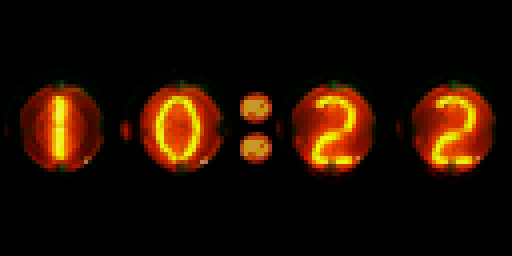
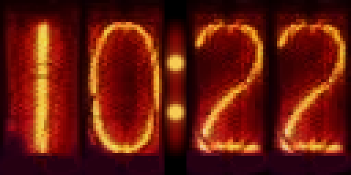

# Nixel Clock

It's a Nixie Tube Clock recreated in Pixels! Available in round or tall styles, with brighter or darker variants.

## Displays

- **64x32**: the original clock.
- **128x64**: twice the detail, with artwork made from the same nixie tube photos as the original.
- **64x64**: the clock is centred on the display.

## Settings

- **Clock style**: Round or Tall, each in a Brighter or Darker version.
- **24 hour format**: show the time as 24 hour instead of 12 hour.
- **Leading zero**: show a leading zero before single-digit hours, e.g. 09:30.
- **Blinking colon**: the colon blinks once a second.
- **Glow**: each tube very gently brightens and dims on its own, as if it's really lit. On by default.
