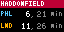
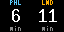

# PATCO

Next scheduled PATCO Speedline trains at your station on a Tidbyt or Tronbyt display. It can show trains toward Philadelphia, trains toward Lindenwold, or both.

PATCO doesn't publish real-time train positions, so the times come from PATCO's official schedule (its GTFS feed). The schedule is rebuilt every day, so weekday, Saturday and Sunday timetables, track-work days and special-event service are all handled automatically. No API key is needed.

## Setup

Pick your **Station** and you're done. Everything else is optional.

## Options

| Setting | What it does |
| --- | --- |
| Station | Any of the 14 stations, Lindenwold to 15-16th & Locust. |
| Direction | Both directions, **To Philadelphia** (westbound) or **To Lindenwold** (eastbound). Lindenwold and 15-16th & Locust only have one direction, so they show it automatically. |
| Layout | **Departure list** shows the next few trains. **Big countdown** shows one large number per direction, readable across a room. |
| Time to reach the platform | Hides trains you can't make. In the Big countdown layout the number becomes *minutes until you should leave*, and shows **GO** when it's time. |
| Show minutes until departure | Show `4, 19 min` instead of clock times for trains within the hour. |

## Display

**Both directions:** the next two trains each way, e.g. `PHL 4, 19 min`. The first train is bright and the next is gray.

**One direction:** the next three departures with their clock times and minutes to go.

**Big countdown:** one large number per direction. With a walk time set, it counts down to when you should leave.

Colors:
- **Blue** `PHL` is toward Philadelphia. **Amber** `LND` is toward Lindenwold.
- **Green** means leave now: the train goes within 5 minutes of when you could reach the platform.
- **Red** `LAST` marks the final train before the overnight break.

Works on 64×32 and 128×64 displays.

## Where the times come from

The app reads small per-station timetables from [jabella/patco-schedule](https://github.com/jabella/patco-schedule). A GitHub Action there downloads PATCO's GTFS feed every day and converts it, so new timetables reach the app without an app update. Each station's file is about 5 KB and is cached for 6 hours. If GitHub can't be reached, the app keeps using the last good copy for up to 2 weeks.

If PATCO's schedule runs out before a new one is published, the app says **Schedule expired** rather than showing times that may be wrong.

These are scheduled times, not live arrivals. Delays and service changes PATCO announces outside its published schedule won't show up here.

Schedule data © PATCO / Delaware River Port Authority.
