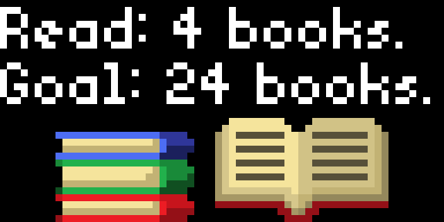

# Goodreads yearly reading challenge progress

Displays the progress of your reading challenge along with different icons to illustrate how many books you've read thus far.



## Goodreads.com

Configure the numeric challenge ID from
`https://www.goodreads.com/user_challenges/{challenge_id}` (not the user ID).
These URLs remain valid even when Goodreads redirects them to a redesigned
page at `/readingchallenges/gr/annual/{year}/{opaque_id}`.

The app reads `readingProgress` and `readingGoal` from the redesigned page's
`window.urcData` JSON. Older pages with a `progressText` HTML block are also
supported. No Goodreads authentication is required for public challenges.

Parsing HTML is more fragile than making a real API call.

## Testing

With Pixlet installed, run the parser regression tests without contacting
Goodreads:

```sh
python3 -m unittest discover -s apps/readingchallenge/tests -v
```
