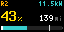

# Rivian for Tronbyt

Shows your Rivian's state of charge, range, charge limit, charging status and lock state on a Tronbyt/Tidbyt display.

Data comes from your own Home Assistant, through the [Rivian (Unofficial)](https://github.com/bretterer/home-assistant-rivian) integration and the Home Assistant REST API. Nothing is sent anywhere else.

## What it shows

- **State of charge**, color-coded green / yellow / red, with **range** in miles or km (taken from Home Assistant).
- A **battery bar** with a tick at your charge limit. While charging, it turns teal and animates.
- A **status line**, most important first: charging power in kW → **UNLOCKED** → **PLUGGED** → **LOCKED** → charge limit.

## Setup

1. Install and set up the [Rivian (Unofficial)](https://github.com/bretterer/home-assistant-rivian) integration in Home Assistant.
2. In Home Assistant, create a **long-lived access token**: your profile → *Security* → *Long-lived access tokens*.
3. Add the **Rivian** app on your Tronbyt and fill in:
   - **Home Assistant URL**: reachable from your Tronbyt server, e.g. `http://homeassistant.local:8123`
   - **Access token**: the token from step 2
   - **Vehicle name**: as it appears in your entity IDs. If your battery sensor is `sensor.r2_battery_state_of_charge`, enter `r2`.

That's it. Every entity ID is derived from the integration's naming.

## Settings

| Setting | Default | Notes |
|---|---|---|
| Display label | vehicle name | Text in the top-left corner, up to 8 characters |
| Show lock status | on | LOCKED / UNLOCKED in the status line |
| Battery %, range, charger state, charger connection, charge limit, charging power, lock | derived from vehicle name | Optional overrides if you've renamed entities; the lock accepts a comma-separated list |

Home Assistant responses are cached for 60 seconds; a 5-minute app interval is plenty. Until it's configured, the app shows sample data marked **DEMO**.
