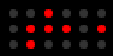

# Simple Binary Clock



Shows the time as three rows of dots (hours, minutes, seconds), each a binary number with the
most significant bit on the left. It animates through 60 seconds per render and supports
64×32, 128×64 and 64×64 displays.

## Settings

- **24-hour clock**: hours as 0–23 instead of 1–12.
- **Show unused hour dots** (on by default): draws unlit dots in the hour row's leftmost
  positions, which the hour never fills.
- **Display lag (seconds)**: Tronbyt sends an app's image while the previous one is still on
  screen, so the clock can start out behind by that long. This shifts the time forward to
  make up for it. When the app is pinned, use its display time (e.g. 60).

## Preview images

To regenerate them, from this folder:

```
pixlet render -z 9 simple_binary_clock.star -o simplebinaryclock.webp
pixlet render -2 -z 9 simple_binary_clock.star -o simplebinaryclock@2x.webp
pixlet render -w 64 -t 64 -z 9 simple_binary_clock.star -o simplebinaryclock@64x64.webp
```
