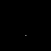

# Skylines

A familiar silhouette. A little starlight. A city coming to life.

Skylines brings city-inspired pixel art to your Tidbyt or compatible Tronbyt display, drawing each skyline into view one point at a time.

Inspired by the understated charm of the Frasier opening titles, the app lets the architecture take center stage before adding a city name or your own personal message. Optional twinkling stars bring a little nighttime atmosphere to the finished scene.

Celebrate a favorite destination, remember a place you’ve called home, or let a different skyline spark a little wanderlust.

Big-city character, beautifully small.

## Display Previews

### Standard Display — 64 × 32

The original compact presentation: a skyline draws itself across the canvas, followed by optional stars and a text overlay.

### Wide 2× Display — 128 × 64

The wide version doubles the skyline’s pixel dimensions and uses a larger text font.

Stars remain individual one-pixel points, adding a delicate contrast to the larger architectural outlines.

### Square Display — 64 × 64

The square version uses a centered 64 × 32 skyline composition rather than stretching the buildings vertically.

The text overlay is positioned using the full canvas height, so its placement differs from the standard presentation.

## Features

- Progressive skyline drawing — Watch the included city artwork appear pixel by pixel.
- Frasier-inspired presentation — A simple architectural silhouette followed by optional text.
- Random city selection — Choose from the entire bundled collection.
- Personal city shortlist — Limit selection to the cities you enable.
- Optional twinkling stars — Adds up to five spaced points of light above the skyline.
- City-name overlay — Identify the featured city after the initial skyline hold.
- Custom text — Add your name, a greeting, or another personal message.
- Text-free mode — Let the skyline and stars speak for themselves.
- Custom colors — Choose the main skyline color and the text color.
- Adjustable animation speed — Controls drawing, twinkling, text playback, and hold duration.
- Bundled artwork — No accounts, API keys, or external image feeds are required.
- Scaled wide presentation — Uses a doubled skyline scale on a 128 × 64 canvas.

## Watch the City Take Shape

The app draws the skyline from left to right, working through one column at a time.

Within each column, it chooses whether to begin at the top or bottom according to the previous drawing position. This gives the reveal a flowing, pen-like character.

Each recorded skyline pixel adds a frame to the animation.

Once the drawing is complete:

1. The finished skyline holds, with stars if enabled.
2. The optional text overlay appears during a second hold.
3. The animation returns to its drawing sequence when replayed.

Cities with more recorded pixels take longer to draw.

## Choose Your Cities

### Display a Random City

Select this mode to draw from the entire bundled city collection.

A city is chosen when the app renders. Replaying an existing animation does not pick another city.

Selections can repeat.

### Pick from Selected

Select this mode to reveal an alphabetical checklist of the included cities.

Leave your favorites enabled and disable the others. The app then chooses from your selected collection.

To keep one city on display, leave only that city enabled.

If every city is disabled, the app falls back to the full collection rather than producing an empty selection.

## Add Your Own Opening Title

The “Text Overlay” setting offers three choices.

### Display City Name

Shows the selected city’s name.

This is the default and makes the app a small rotating showcase of the included skyline collection.

### Display No Text

Keeps the presentation focused on architecture and optional stars.

The completed scene still holds before the loop repeats.

### Display Custom Text

Uses the words entered in “Custom Text” instead of the city name.

Try:

- Your name
- A greeting
- A favorite short phrase
- A label for your desk or room
- A message that belongs with a memorable city

If Custom Text is selected but the field is blank, the app falls back to the city name.

The overlay uses scrolling text on a black strip, which can cover part of the scene beneath it.

## A Few Stars Above the Rooftops

“Display Stars” is enabled by default.

The app looks for open-sky positions above the drawn skyline, leaving clearance from the buildings and spacing between selected stars.

It attempts to place up to five stars. A skyline with limited suitable space may show fewer.

The stars:

- Appear during the completed-scene portion of the animation.
- Twinkle with staggered timing.
- Move through dim blue, cool white, bright white, and warm-white shades.
- Briefly disappear during one phase of the cycle.
- Remain in fixed positions within a rendered animation.

This is an artistic star field, not an astronomical map.

## Make It Your Own

Two color settings are available:

| Setting | Default |
| --- | --- |
| Skyline | White |
| Text | Blue |

The Skyline setting changes the main outline color.

Artwork can also include red and green detail pixels. Those accents retain their predefined colors rather than following the main skyline setting.

Star colors are defined by the animation and are not independently configurable.

## Set the Pace

The “Speed” setting controls the delay between frames.

| Setting | Frame delay |
| --- | --- |
| Slow Scroll | 70 milliseconds |
| Medium Scroll | 45 milliseconds |
| Fast Scroll | 20 milliseconds |

Changing this setting affects more than scrolling:

- Skyline drawing speed
- Star-twinkle timing
- Text playback
- Completed-scene holds

At the default Slow setting, the completed skyline holds for approximately seven seconds before the text phase begins. The text phase then lasts approximately 5.6 seconds.

If text is disabled, the completed scene remains visible through both hold phases.

Long custom messages are not guaranteed to complete a full scroll during the fixed text phase.

## Get Started

No accounts, API keys, or external data feeds are required.

1. Add Skylines to your display.
2. Open the app’s settings.
3. Choose a random city or a selected-city shortlist.
4. Decide whether to show stars.
5. Select a city-name, custom-text, or text-free presentation.
6. Choose your skyline and text colors.
7. Set your preferred speed.
8. Save your settings and watch the city take shape.

## Available Settings

| Setting | What it does |
| --- | --- |
| Speed | Controls the drawing and animation frame delay. Defaults to Slow Scroll. |
| Display Stars | Adds twinkling stars above the finished skyline. Enabled by default. |
| Skyline | Sets the main skyline color. Defaults to white. |
| Text | Sets the overlay text color. Defaults to blue. |
| Text Overlay | Chooses city name, no text, or custom text. Defaults to city name. |
| Custom Text | Supplies the message used by the custom-text option. |
| What to display | Chooses the full collection or a selected-city shortlist. |
| City checklist | Enables cities for shortlist mode. Entries default to enabled. |

## For Tinkerers: Skyline Artwork

City artwork is included in:

[View the skyline dataset](skylines_data.star)

The folder also includes a browser-based tracing tool:

[View the Skyline Tracer source](Skyline_Tracer.html)

Artwork customization is a source-level project, not an app setting.

Each skyline dataset is a rectangular grid whose values identify:

- `0` — Empty space
- `1` — Main skyline color
- `2` — Red detail
- `3` — Green detail

The renderer checks that rows have matching widths and contain only these supported values.

## Notes

- The app uses its bundled collection rather than downloading current city imagery.
- Skylines are stylized pixel artwork, not complete or continuously updated architectural records.
- Random selection can choose the same city on consecutive renders.
- A single animation loop does not cycle through multiple cities.
- The text overlay appears after the initial completed-skyline hold.
- Text uses a compact display font, not an exact recreation of the Frasier title typography.
- Wide rendering enlarges skyline pixels, but stars remain one pixel each.
- The current square-canvas text positioning uses the full panel height rather than the bounded skyline height.
- This is a fan-inspired visual presentation, not an official Frasier product.

---

A little architecture. A little atmosphere. A city worth another glance.

Created by Robert Ison.
