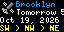
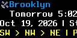
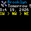

# Spot the Station

A small reminder that something extraordinary is passing overhead.

Spot the Station brings upcoming International Space Station viewing opportunities to your Tidbyt or compatible Tronbyt display.

Choose your observing location and see the next matching predicted visible pass, including its local start time, direction across the sky, peak elevation, duration, and a simple brightness description. An animated station icon adds a little orbital personality.

It’s a convenient invitation to step outside, look up, and catch a glimpse of the station crossing your sky.

## Display Previews

### Standard Display — 64 × 32

A compact observing dashboard with an animated ISS icon, location, pass timing, and scrolling viewing details.

### Wide 2× Display — 128 × 64

The wide version uses larger text and wider scrolling regions for pass information.

The station artwork retains its original image dimensions rather than automatically doubling in size.

### Square Display — 64 × 64

The square version retains the standard-font, stacked information layout on a taller canvas.

The current code does not add a separate vertically centered square composition.

## Features

- Location-specific predictions — Requests visible ISS passes for your chosen latitude and longitude.
- Next matching pass — Selects the earliest eligible pass, including one already in progress.
- Local dates and times — Uses your selected location’s time zone.
- Near-pass countdown labels — Shows seconds or minutes remaining as the start approaches.
- In-progress presentation — Changes to “Visible now” during the returned pass interval.
- Direction guidance — Displays the pass’s start, peak, and end compass directions.
- Peak elevation — Shows how high the station is predicted to reach.
- Duration filtering — Prefer longer viewing opportunities.
- Elevation filtering — Prefer passes that climb higher above the horizon.
- Notice-period filtering — Show passes only when they fall within your chosen interval.
- Brightness descriptions — Translates the returned magnitude into a simple descriptive label.
- Animated station icon — Adds visual interest beside the location and timing.
- Cached predictions — Reuses the response for 24 hours under normal cache behavior.
- Automatic sample mode — Demonstrates the display when no API key is entered.

## Before You Begin

Live predictions require an N2YO API key.

The app requests visual passes for the International Space Station using satellite ID `25544`.

It does not use a NASA prediction feed, despite the familiar “Spot the Station” name.

## Setup

### 1. Get Your N2YO API Key

1. Create or sign in to an account at N2YO.com.
2. Open your profile and locate the API-key controls.
3. Generate or retrieve an API key for use with the service.
4. Review the provider’s current usage limits and terms.

[Visit N2YO](https://www.n2yo.com/)

### 2. Configure the App

1. Add Spot the Station to your display.
2. Open the app’s settings.
3. Enter your key in “N2YO.com API Key.”
4. Choose your observing location.
5. Select a notice period, minimum duration, and pass-elevation preference.
6. Choose your scrolling speed.
7. Save your settings.

Keep your API key private. Do not include it in screenshots, public configuration files, or repository commits.

### 3. Check the Display

With a working key and a matching prediction, the app shows the selected pass.

If no pass qualifies, it explains which filters are preventing a match—unless you enable “Hide When No Matching Pass.”

Use “Display Instructions” for scrolling setup help, then turn it off to return to predictions.

## Choose Your Observing Location

The location setting supplies:

- Latitude and longitude for the prediction request
- A locality or description for the heading
- A time zone for displayed dates and times

If no location setting is supplied, the code’s default location is Brooklyn, New York.

Set your actual observing location before using the times and directions.

The request uses an observer altitude of zero meters. There is no altitude setting in the current app.

## Reading the Display

### Location

The blue heading identifies the selected observing locality.

If a long locality contains a comma, the app may shorten it to the portion before that comma.

### Pass Timing

The main timing label changes according to how close the pass is.

Examples include:

- In 35s
- In 12m
- Tonight 8:15 PM
- Tomorrow 5:42 AM
- Visible now

For passes farther ahead, the label may show only the clock time. The separate date row remains available to identify the correct day.

### Exact Local Start

The date row includes the local date and pass start time:

> Jan 2, 2026 | Starts 8:15 PM

This preserves an exact reference when the main label uses a countdown or relative-day wording.

### Viewing Details

Before a pass starts, the scrolling details follow this pattern:

> NNW > NE > ESE | Peak 45 deg | 5m 20s | Very bright

The directions represent:

1. Start direction
2. Direction at peak elevation
3. End direction

They describe where to look in the sky—not the station’s geographic ground track.

## During a Pass

When the current render time falls between the returned start and end timestamps, the main label becomes:

> Visible now

The details then emphasize time remaining.

Before the predicted peak, the app can show:

- Time until the pass ends
- Peak elevation and direction
- Time until peak
- Brightness description

After the predicted peak, it can show:

- Time until the pass ends
- Direction toward which the pass ends
- Brightness description

“Visible now” means the render time falls within the predicted interval. It does not confirm clear skies or that you can actually see the station.

## Choose Better-Matching Passes

### Minimum Duration

Select a minimum total visible duration from one through ten minutes, or allow any returned pass.

This filter uses the duration supplied by N2YO.

For a pass already in progress, it checks the total predicted duration—not how much viewing time remains.

### Types of Passes

This setting filters by maximum elevation above the horizon.

| Choice | Minimum peak elevation |
| --- | --- |
| Low passes or higher | 5 degrees |
| Moderate passes or higher | 20 degrees |
| High passes or higher | 40 degrees |
| Very high passes | 60 degrees |

The filter applies to the predicted peak, not the station’s elevation at every moment of the pass.

### Notice Period

Choose an interval from one hour to one week, or:

> Always display next matching sighting if known

A finite notice period requires the pass to start within that interval. An otherwise qualifying pass already in progress can also be selected.

“Always display” still operates only on predictions available in the returned dataset.

## Brightness Labels

The app translates the returned magnitude into these descriptive categories:

| Returned magnitude | Display label |
| --- | --- |
| Below -3 | Extremely bright |
| -3 to below -1 | Very bright |
| -1 to below 0 | Bright |
| 0 to below 2 | Naked-eye visibility |
| 2 to below 4 | Dark skies preferred |
| 4 to below 6 | Faint |
| 6 or higher | Very faint |
| Missing or recognized unknown value | Brightness unknown |

These are labels defined by the app, not guarantees of visibility at your site.

There is no user-adjustable brightness filter.

## No Key? You’re Seeing a Sample

Leaving the API-key field blank activates sample mode.

The app uses bundled demonstration data and shifts its start to ten minutes after the current render time.

The display includes:

- “Sample:” in the timing label
- “Sample only, not a real prediction” in the details

No live N2YO request is made in this mode.

### Sample Filters Still Apply

The demonstration pass lasts 555 seconds and reaches approximately 20 degrees, with a stored peak value just below 20.

As a result:

- The 5-degree elevation setting allows it.
- A 20-degree-or-higher minimum excludes it.
- A ten-minute duration minimum excludes it.

If the sample disappears or reports no match, check those filters.

Because its start moves ten minutes into the future on every render, sample mode is not a persistent countdown toward an actual event.

## Predictions and Refresh Behavior

The app requests ten days of visible-pass predictions and caches the response for 24 hours.

It requests passes with a broad minimum visibility duration, then applies your selected filters locally.

Changing duration, elevation, or notice settings does not change the prediction-request URL.

Changing the location or API key does change that URL and can require a new request.

### A Rendered Countdown Is a Snapshot

Timing labels are calculated when the app renders.

Replaying the same animation does not independently decrement the countdown, advance to the next pass, or switch to “Visible now.”

Those changes require another render.

The underlying prediction response can remain cached while each render selects the next eligible pass and updates its timing text.

## Available Settings

| Setting | What it does |
| --- | --- |
| N2YO.com API Key | Enables live predictions. Blank activates sample mode. |
| Location | Sets the observing coordinates, heading, and local time zone. |
| Notice Period | Limits how far ahead a matching pass can start. Defaults to Always Display. |
| Minimum Duration | Filters by total predicted visible duration. Defaults to any returned pass. |
| Types of Passes | Sets the minimum peak elevation. Defaults to 5 degrees. |
| Scroll | Selects slow, medium, or fast playback. Defaults to Medium Scroll. |
| Hide When No Matching Pass | Hides unmatched results instead of showing an explanation. Disabled by default. |
| Display Instructions | Shows scrolling setup help instead of predictions. |

## Troubleshooting

### The Display Says “Sample”

The API-key field is blank.

Enter a working N2YO key for actual predictions.

### No Matching Passes

Try:

1. Setting Notice Period to Always Display.
2. Allowing any returned duration.
3. Selecting the 5-degree elevation minimum.
4. Confirming your location.

The app distinguishes between insufficient duration, insufficient elevation, combined-filter exclusions, and notice-period exclusions.

An empty result can be valid; suitable passes are not guaranteed within the cached prediction window.

### API Request Failed

Check the HTTP status shown, network access, API key, and provider account limits.

### N2YO API Error

Verify the key and account with N2YO.

The app intentionally avoids displaying raw API error text that could expose request details.

### The Time or Location Looks Wrong

Confirm the selected location and its time zone.

The location setting affects both predictions and local-time formatting.

### The Timing Seems Frozen

Check your hosting system’s render interval.

A replayed WebP contains the timing text from its original render.

## Important Limitations

- Predictions do not account for your actual cloud cover, buildings, trees, or terrain.
- The app does not retrieve local weather.
- A high or bright pass can still be obscured.
- “Visible now” is based on predicted timestamps, not a live sighting.
- The animated station icon is decorative, not live orientation or telemetry.
- Displayed peak elevations are truncated to whole degrees, while filtering uses the underlying numeric value.
- The app does not draw a sky chart or ground-track map.
- It does not send push notifications or sound an observing alarm.
- Cached predictions can become outdated.
- Sample data must not be used to plan a real sighting.

---

A little notice. A clear view. A reason to look up.

Created by Robert Ison.
