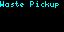
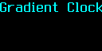
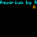

# Tronbyt Updates

Your display’s next favorite app might already be waiting.

Tronbyt Updates brings recent app-repository activity to your Tronbyt display in a colorful, scrolling briefing.

Discover an app that has changed, see its author and current description, and read the associated commit summary—all without opening GitHub. Additional recently changed apps appear in an “Also updated” list, giving you a little inspiration for your next trip through the app collection.

A small window into a community that keeps building.

## Display Previews

### Standard Display — 64 × 32

A compact scrolling briefing featuring an app’s name and author, its description and change summary, and an optional list of other updated apps.

### Wide 2× Display — 128 × 64

The wide version uses larger fonts and the full canvas width for its scrolling text.

The featured app line uses a slightly larger font than the detail rows.

### Square Display — 64 × 64

The square presentation retains the standard text size and stacked scrolling rows on the taller canvas.

The current script does not add a separate vertically centered square layout.

## Features

- Recent app-change discovery — Examines the latest 30 commits on a selected repository branch.
- Up to six distinct apps — Builds a candidate list without repeating the same app folder.
- Featured-app selection — Randomly chooses one candidate to spotlight on each render.
- Current metadata — Reads the app name, author, and description from a consistent checked branch snapshot.
- Commit summaries — Shows the first line of the associated commit message.
- Other-update list — Names additional qualifying apps from the candidate list.
- Custom repository and branch — Follow the default Tronbyt collection or a compatible fork.
- Optional authentication — Add a GitHub token for authenticated requests and shorter cache intervals.
- Broken-app filtering — Skips apps marked broken in their current manifest.
- Partial-result warnings — Displays usable results with a warning when some requests or scans are incomplete.
- Adjustable scrolling — Choose slow, medium, or fast playback.
- On-device instructions — Provides setup and refresh information.

## What Counts as an Update?

The app looks for changed files beneath:

    apps/<app-folder>/

Any file change in that folder can qualify—not just a change to the main script.

Examples include:

- App code
- Manifest metadata
- Artwork
- Preview images
- README documentation

A listed update therefore means the repository contains a recent change associated with that app folder. It does not necessarily mean a new feature, a published release, or an update already installed on your device.

This app reports repository activity. It does not install updates.

## How Apps Are Selected

The app:

1. Retrieves the latest 30 commits from your chosen branch.
2. Examines their changed-file lists.
3. Identifies folders beneath `apps/`.
4. Keeps the newest observed change for each folder.
5. Reads qualifying app metadata from the checked branch snapshot.
6. Stops after collecting up to six usable app entries.
7. Randomly chooses one entry for the featured display.

The featured app is not necessarily the single newest app in the list.

Selection can repeat across renders. Replaying an existing rendered image repeats the same featured app.

## Reading the Display

### Featured App and Author

The first row shows:

> App Name by Author

Author information comes from the app manifest, not the commit author.

If no usable author name is available, the app displays “Unknown.”

### Description and Change Summary

The next row combines the available app description with:

> Changes: …

The change text is the first line of the relevant commit message.

For a commit touching several apps, the same commit-wide message can appear for each affected app. It is not an automatically generated explanation of that app’s individual code changes.

### Also Updated

When other candidates are available, another row lists their app names.

This is a summary of the remaining candidate entries—not a complete repository-wide changelog.

### Partial Results

If some lookups fail or a large commit cannot be fully scanned, the app can append:

> Partial results: …

Usable entries remain visible even when the hide-on-error option is enabled.

## Choose a Repository and Branch

The defaults are:

| Setting | Default |
| --- | --- |
| GitHub Repository | `Tronbyt/apps` |
| GitHub Branch | `main` |

Enter a repository in this format:

    owner/repository

For example, to follow this fork:

    rjison/apps

Do not enter a complete GitHub URL in the repository field.

The selected repository must use a compatible structure, with app folders under `apps/` and usable manifest files.

The branch must exist and be accessible to your request.

## Optional GitHub Token

A token is optional for public repositories.

Without a token, the app uses unauthenticated requests and an eight-hour cache interval for the branch listing and app metadata.

With a token, it uses authenticated requests and a one-hour interval for those requests.

To configure one:

1. Obtain a GitHub token appropriate for the repository you want to read.
2. Grant only the read access needed for your chosen repository.
3. Paste it into “GitHub Token.”
4. Save your settings.

The script reads repository information; it does not require write access.

Private repositories and organization-controlled resources may require additional authorization according to the applicable GitHub policies.

Keep the token private. Do not include it in screenshots, repository commits, or public configuration files.

## Refreshes and Caching

Different request types use different cache lifetimes:

| Request | Without a token | With a token |
| --- | --- | --- |
| Branch commit list | 8 hours | 1 hour |
| App manifest metadata | 8 hours | 1 hour |
| Individual commit details | 16 hours | 2 hours |

These are request-cache settings, not a guaranteed background polling schedule.

Freshness also depends on how often your hosting system renders the app, cache retention, API availability, and GitHub updates.

A new render can select a different featured app while reusing the same cached candidate data.

### One Render Can Make Several Requests

This is not a single-request update checker.

On cache misses, it may request:

- The branch commit list
- Details for multiple commits
- Additional changed-file pages
- Manifest data for candidate app folders

A token does not eliminate API rate limits. Repeated testing, multiple installations, and other applications can contribute to your overall usage.

The app does not track a monthly request budget or provide a separate error-retry backoff.

## Current Metadata, Recent Commit Messages

The app takes the newest commit in its retrieved branch listing as a snapshot.

All manifests for that scan are read from that same snapshot.

This means the displayed name, author, and description describe the app as it exists in the checked snapshot—not necessarily as it existed when the associated change was originally committed.

The commit summary still comes from the newest observed change for that app folder.

## What Gets Skipped?

An app folder can be omitted when:

- Neither `manifest.yaml` nor `manifest.yml` exists in the checked snapshot.
- Its manifest marks it as broken.
- Its manifest does not provide a usable app name.
- Metadata cannot be retrieved or decoded successfully.

Missing manifests are treated as normal exclusions, which also helps omit removed folders and directories that are not current apps.

## Scan Limits

The app deliberately bounds its work:

- Latest 30 commits
- Up to six qualifying distinct apps
- Up to three changed-file pages per examined commit
- Up to 100 files per page

Large commits can therefore be incompletely scanned. When the scan reaches its file-page limit, the app reports a warning.

This is a lightweight discovery tool, not a complete audit of every recent repository change.

“Recent” is defined by the commit window, not by a fixed number of hours or days.

## Get Started

1. Add Tronbyt Updates to your display.
2. Open the app’s settings.
3. Keep `Tronbyt/apps`, or enter a compatible repository.
4. Confirm the branch name.
5. Optionally enter a GitHub token.
6. Choose your scrolling speed.
7. Decide whether to hide empty results and handled errors.
8. Save your settings.

Enable “Display Instructions” for scrolling help, then turn it off to return to app discoveries.

## Available Settings

| Setting | What it does |
| --- | --- |
| GitHub Repository | Sets the repository in `owner/name` format. Defaults to `Tronbyt/apps`. |
| GitHub Branch | Sets the branch to inspect. Defaults to `main`. |
| GitHub Token | Optionally authenticates requests and selects shorter cache intervals. |
| Hide if no updates or errors. | Hides when no qualifying or usable results remain. Enabled by default. |
| Scroll | Selects slow, medium, or fast playback. Defaults to Slow Scroll. |
| Display Instructions | Shows scrolling setup and refresh information. |

## Troubleshooting

### Nothing Appears

The app hides empty results and handled errors by default.

Temporarily disable “Hide if no updates or errors.” to see the explanation.

There may be no qualifying app changes within the latest 30 commits, or a request may have failed.

### Invalid Repository

Enter only:

    owner/repository

Do not include `https://github.com/`, a branch path, or extra slashes.

### Token Rejected

Check whether the token was copied correctly, expired, or revoked.

Replace it in the app settings if needed.

### Access Denied or Rate Limited

Review repository access, organization policies, and GitHub rate-limit information.

An HTTP 403 message alone does not distinguish those causes.

### Not Found or Not Accessible

Check the repository and branch names, along with the token’s access if authentication is required.

### Partial Results

Some data was usable, but a request or bounded scan was incomplete.

The displayed list may omit qualifying apps. Review the warning rather than treating the list as exhaustive.

### An App Appears Repeatedly

Repeated appearances are possible because selection is random and candidate data remains cached.

This does not mean another update occurred each time.

## Notes

- The app does not compare installed versions with repository versions.
- It does not install, enable, or update other apps.
- Documentation and preview-image changes can qualify as updates.
- App authors come from manifests, not commit authorship.
- Change summaries are commit messages, not verified release notes.
- The display does not currently show commit dates, version numbers, or clickable links.
- Current manifest metadata is read from a consistent checked snapshot.
- No separate last-successful-results fallback is implemented.
- API errors, malformed data, or source changes can interrupt rendering.

---

Keep an eye on what’s changing—and discover something worth adding.

Created by Robert Ison.
