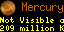
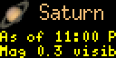
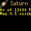

# Visible Planets

A little perspective on the worlds beyond our own.

Visible Planets turns your Tidbyt or compatible Tronbyt display into a compact companion for exploring the solar system.

Choose a planet for a closer look at its direction, elevation, brightness, constellation, and distance—or use Full Sky View for a miniature overview of the planets and Moon above your horizon.

During daytime, the app looks ahead to 30 minutes after sunset. At night, it uses a recent calculation time to give you a rough guide to where to look.

A small display, a much bigger neighborhood, and another reason to step outside.

## Display Previews

These previews feature Saturn with metric distances and a Brooklyn, New York observing location.

### Standard Display — 64 × 32

The compact planet-detail presentation combines planet artwork, a colored name, and two scrolling information rows.

### Wide 2× Canvas — 128 × 64

The current script retains its original artwork, fonts, and 64-pixel scrolling regions on the larger canvas.

This is not yet a separately enlarged 2× layout.

### Square Display — 64 × 64

The square render retains the compact information layout on the taller canvas.

The current code does not stretch or vertically center the presentation specifically for square panels.

## Features

- Seven individual planet views — Choose Mercury, Venus, Mars, Jupiter, Saturn, Uranus, or Neptune.
- Full Sky View — Maps the included planets and Moon that are above the calculated horizon.
- Location-aware positions — Uses your selected observing coordinates.
- Direction and elevation — Shows a compass direction and degrees above the horizon.
- Calculation-time labels — Individual views identify whether positions are a nighttime snapshot or an evening preview.
- Magnitude information — Displays the returned magnitude when available.
- Constellation context — Names the constellation supplied by the position service.
- Earth-distance display — Choose kilometers or miles, formatted with readable large-number labels.
- Below-horizon hiding — Optionally omit an individual planet when it is below the calculated horizon.
- Adaptive request caching — Uses different calculation-time buckets and cache durations around sunrise, sunset, and nighttime.
- Adjustable scrolling — Choose slow, medium, or fast playback for individual planet details.

## Choose Your View

### Individual Planet

Select a planet to display:

- Its artwork and name
- The calculation-time label
- Compass direction and elevation
- Available magnitude
- A brightness description for planets other than Mercury and Venus
- Available constellation name
- Available distance from Earth

If optional details are missing, the app displays what remains rather than substituting another planet.

If the requested planet lacks usable position coordinates, it returns no display.

### Full Sky View

Select Full Sky View for a compact chart of the supported planets and Moon above the horizon at the calculation time.

The chart is a rough directional guide, not a scaled planetarium view.

It remains visible even when no supported objects are above the horizon, provided the response contains a usable body-row list.

## Reading an Individual Planet View

### Which Direction?

The first scrolling row uses one of 16 compass directions, such as:

- North
- NE
- East
- SSW
- West

The direction describes where the planet is at the displayed calculation time.

### How High?

The elevation is shown in degrees above the horizon.

The displayed value is rounded downward to a whole degree.

A planet’s calculated elevation does not account for buildings, trees, terrain, clouds, or your actual viewing conditions.

### Brightness, Constellation, and Distance

The second row combines the available details.

Magnitude descriptions are simple labels defined by the app. Treat them as general guidance—not a guarantee that a planet can be seen with a particular instrument or from your location.

Mercury and Venus show their magnitude without the additional visibility description.

Distance can be displayed in:

- Kilometers with Metric selected
- Miles with Imperial selected

## Daytime: A Preview of the Evening

Between the calculated sunrise and sunset, the app requests positions for:

> 30 minutes after sunset

Individual views label this:

> Tonight at …

Both direction and below-horizon filtering refer to that future calculation time—not the planet’s position at the moment you glance at the display.

This can help you plan an evening look, but 30 minutes after sunset does not necessarily mean a fully dark sky.

## Nighttime: Check the Timestamp

At night, positions use a rounded calculation time:

- Within 30 minutes of sunrise or sunset: the beginning of a 15-minute bucket.
- Outside those windows: the beginning of the current hour.

Individual views label this:

> As of …

The label identifies the requested calculation time, rather than implying a continuously updated live position.

Replaying an existing animation does not recalculate the sky.

## Reading Full Sky View

### Object Codes

| Code | Object |
| --- | --- |
| E | Mercury |
| V | Venus |
| M | Mars |
| J | Jupiter |
| S | Saturn |
| U | Uranus |
| N | Neptune |
| O | Moon |

Mercury uses “E” to distinguish it from Mars. The Moon uses “O.”

The Sun is not included in the summary’s plotted object list.

### Horizontal Position: Direction

The bottom scale reads:

    S  W  N  E  S

South appears at both ends because the chart wraps around the compass.

A letter’s horizontal position gives an approximate direction along that scale.

### Vertical Position: Height

Higher rows represent higher calculated elevations.

The chart uses five altitude bands, each spanning approximately 18 degrees.

Objects must be strictly above zero degrees to be plotted.

### When Objects Overlap

If two objects would occupy the same chart cell, the later object is moved to the nearest available cell.

This keeps their codes readable, but means a displayed letter can be displaced from its ideal direction or elevation.

Use an individual planet view for the numerical elevation and compass label.

### Colors

Letter colors are assigned from magnitude ranges, generally using yellow shades for brighter objects and subdued shades for fainter ones.

Unknown magnitudes use white, and the faintest range also falls back to white. Color is therefore not a continuous or universally ordered brightness scale.

### Summary Timing

Full Sky View uses the same calculation time as the individual views, but it does not display that timestamp.

During daytime it represents the evening preview; at night it represents the selected time bucket.

## Hide Below-Horizon Planets

“Hide if not visible” applies only to individual planet views.

When enabled, a planet below zero degrees at the calculation time returns no display.

When disabled, the app shows “Below the horizon” and an available Earth-distance value.

This setting does not evaluate darkness, weather, glare, or obstructions. “Above the horizon” is not the same as “easy to observe.”

Full Sky View ignores this toggle and plots only supported objects above its calculated horizon.

## Get Started

1. Add Visible Planets to your display.
2. Open the app’s settings.
3. Select your observing location.
4. Choose an individual planet or Full Sky View.
5. Select Metric or Imperial distance units.
6. Choose a scrolling speed.
7. Decide whether individual planets should hide below the horizon.
8. Save your settings.

The code’s default location is Orlando, Florida. Set your own location for relevant positions.

For a useful combination, create one Full Sky View instance and separate instances for the planets you most want to follow.

Each instance still needs rendering and may generate requests; do not assume multiple instances always share cached responses.

## Available Settings

| Setting | What it does |
| --- | --- |
| Planet | Selects one planet or Full Sky View. Defaults to Full Sky View. |
| Location | Supplies observing coordinates and time zone. |
| Measurement | Chooses kilometers or miles for individual-view distances. Defaults to Metric. |
| Scroll | Sets individual-detail scrolling speed. Defaults to Slow Scroll. |
| Hide if not visible | Hides an individual planet below the calculated horizon. The settings form defaults to enabled. |

The scrolling setting does not change the static Full Sky View chart.

## Position Data and Requests

Positions are retrieved from AstronomyAPI.

The app makes one all-body-position request per normal render, subject to HTTP caching, rather than a separate request for each displayed object.

Before the request, observing coordinates are rounded to the nearest 0.1 degree. Sunrise and sunset calculations use the original coordinates.

The request uses an observer elevation of zero meters.

The current script includes service authentication in its source and does not expose a personal API-key field in settings. Service access depends on that configured credential remaining valid and available.

## Cache Behavior

The requested HTTP cache duration is:

- 15 minutes near sunrise or sunset.
- One hour at night outside those windows.
- A variable duration during daytime, based on the time remaining before sunset, with a minimum of one minute.

These settings reduce repeated requests but do not guarantee a particular request count.

Actual behavior depends on rendering frequency, request parameters, cache retention, and service availability.

## If Nothing Appears

The current script can return no display when:

- The selected individual planet is below the horizon and hiding is enabled.
- The planet setting is invalid.
- Location coordinates or the time zone are missing or invalid.
- The API request fails or lacks usable body data.
- The selected planet’s required coordinates are unavailable.

There is no dedicated on-screen error message for these handled cases.

When troubleshooting, disable below-horizon hiding, confirm the location, and inspect render logs and service access.

## Important Limitations

- This is a compact observing guide, not a precise navigation or telescope-control system.
- The app does not check local weather or obstructions.
- Brightness descriptions are approximate app-defined guidance.
- Coordinates are rounded before position requests.
- Full Sky View can move overlapping objects to nearby cells.
- The summary does not display its calculation time.
- Positions update when rendered, not continuously during image playback.
- High-latitude sunrise and sunset edge cases are not explicitly handled.
- No rise/set timetable, sky-quality assessment, or safe solar-observation guidance is provided.

---

A little planetary perspective, right where you can see it.

Created by Robert Ison.
