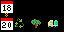
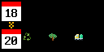
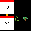

# Waste Pickup Reminder

A little reminder today. One less scramble tomorrow.

Waste Pickup Reminder turns your Tidbyt or compatible Tronbyt display into a colorful, glanceable guide to your household collection schedule.

See what’s scheduled for today and tomorrow, with calendar tiles and icons for garbage, recycling, yard waste, and bulk waste. When nothing is due soon, let the app quietly disappear—or keep the next scheduled pickup in view.

Simple, practical, and much nicer than remembering the bins just as the truck turns the corner.

## Display Previews

### Standard Display — 64 × 32

Two compact calendar tiles show today’s date and tomorrow’s date, with scrolling pickup details beside each.

When next-pickup mode is active, the lower tile shows the next scheduled collection date instead.

### Wide 2× Display — 128 × 64

The wide version scales the calendar layout and uses larger pickup text and icons, with more horizontal room for collection details.

### Square Display — 64 × 64

The square layout uses the taller canvas for larger calendar tiles, placing one date in each half of the display.

Pickup text retains the standard font, with the remaining horizontal space used for scrolling.

## Features

- Today and tomorrow at a glance — See the collection types scheduled for both days.
- Four waste categories — Configure garbage, recycling, yard waste, and bulk waste.
- Flexible weekly scheduling — Enable any combination of weekdays for each category.
- Multiple pickups per day — Show several collection types together.
- Calendar-style date tiles — Red headers and white date tiles keep the layout easy to recognize.
- Optional icons-only mode — Use compact symbols instead of icons with category names.
- Next-pickup view — Show the next scheduled collection when today and tomorrow are both empty.
- Date-jump indicator — An amber double-chevron marks when the lower tile skips ahead beyond tomorrow.
- Quiet-period hiding — Optionally omit the app when nothing is scheduled today or tomorrow.
- Adjustable scrolling — Choose slow, medium, or fast playback.
- Self-contained scheduling — No accounts, API keys, or external collection feeds are required.

## Set Up Your Weekly Schedule

The app uses the weekdays you select. It does not look up your address or retrieve a municipal collection calendar.

For each waste category, enable the appropriate pickup days:

- Garbage
- Recycling
- Yard Waste
- Bulk Waste

You can select more than one day per category, and several categories can share the same day.

For example:

| Category | Example schedule |
| --- | --- |
| Garbage | Monday and Thursday |
| Recycling | Thursday |
| Yard Waste | Wednesday |
| Bulk Waste | Friday |

These are examples only. Enter the schedule supplied by your own collection provider.

All weekday selections are off by default.

## Reading the Display

### Top Calendar: Today

The upper calendar tile shows today’s day of the month.

The text beside it lists today’s configured pickups.

If nothing is scheduled today, that pickup row is blank. The calendar tile can still remain visible when tomorrow has a pickup.

### Bottom Calendar: Tomorrow—or the Next Pickup

Normally, the lower tile shows tomorrow’s date and its configured pickups.

If both today and tomorrow are empty, the “When Nothing Is Due Soon” setting determines what happens:

- Skip the app.
- Show the next scheduled pickup date.

### Amber Double-Chevron: A Date Jump

When the app skips beyond tomorrow to a later pickup date, a small amber double-chevron appears between the calendar tiles.

It means:

> The lower calendar is the next pickup date, not tomorrow.

The upper tile still shows today.

Calendar tiles display the day number only, not the month or weekday. Pay attention to the date-jump marker when interpreting the lower tile.

## Choose What Happens During Quiet Periods

### Skip App

This is the default.

If there are no configured pickups today or tomorrow, the app returns no display.

It is useful when you want the reminder to appear only as collection day approaches.

### Show Next Pickup Date

When today and tomorrow are both empty, the app searches the following days for the next configured collection.

It checks dates two through seven days ahead, stopping at the first date with a pickup.

If several waste categories share that date, they appear together.

If no pickup is configured anywhere in the weekly schedule, the app remains hidden.

This is not a separate “always show the next pickup” layout: today and tomorrow take priority whenever either has a scheduled collection.

## Icons and Labels

The app uses these category symbols:

| Category | Symbol |
| --- | --- |
| Garbage | 🗑️ |
| Recycling | ♻️ |
| Yard Waste | 🌳 |
| Bulk Waste | 🚛 |

With “Icons Only” disabled, each symbol appears with its category name.

Enable it for a more compact presentation using just the symbols.

When several categories share a date, they appear in the app’s fixed category order: garbage, recycling, yard waste, then bulk waste.

Actual symbol appearance depends on the rendering environment’s font support.

## Get Started

1. Add Waste Pickup Reminder to your display.
2. Open the app’s settings.
3. Enable the pickup weekdays for each waste category.
4. Choose what should happen when today and tomorrow are empty.
5. Enable “Icons Only” if you prefer a compact display.
6. Choose your scrolling speed.
7. Save your settings.

If nothing appears immediately, check your schedule and the quiet-period behavior. With the default Skip App setting, hiding can be the expected result.

## Available Settings

| Setting | What it does |
| --- | --- |
| When Nothing Is Due Soon | Skips the app or shows the next pickup when today and tomorrow are empty. Defaults to Skip App. |
| Icons Only | Hides waste-category names and keeps their symbols. Disabled by default. |
| Scroll | Selects slow, medium, or fast playback. Defaults to Slow Scroll. |
| Monday–Sunday for each category | Defines the repeating weekly pickup schedule. All days are disabled by default. |

Each of the four categories has its own seven weekday toggles.

## Time Zone and Date Changes

The app uses the runtime time zone through `time.tz()`.

There is no separate location or time-zone setting in the app. Configure the appropriate time zone in your display or hosting environment.

The code anchors date calculations around local noon to reduce problems near midnight and daylight-saving transitions.

Dates and pickup rows are calculated when the app renders. Replaying an existing image does not automatically update it after midnight.

## Weekly Reminders, Not a Municipal Calendar

Every enabled weekday repeats each week.

The current app does not support:

- Every-other-week collection
- Monthly rules
- Specific-date overrides
- Holiday delays
- Seasonal schedule changes
- Provider cancellations
- Automatic address-based lookup

If your service uses alternating weeks or holiday exceptions, the displayed schedule will not account for them automatically.

Check your provider’s current collection calendar and adjust settings as needed.

## Troubleshooting

### Nothing Appears

Check whether:

- At least one pickup weekday is enabled.
- Today or tomorrow has a configured pickup.
- “When Nothing Is Due Soon” is set to Skip App.

Choose Show Next Pickup Date if you want to see a later weekly collection.

### The Lower Date Is Not Tomorrow

Look for the amber double-chevron.

The app may be showing the next collection date because both today and tomorrow are empty.

### A Calendar Has No Pickup Text

That date has no selected waste categories.

An empty row is intentional, not necessarily a rendering problem.

### Dates Seem Wrong

Check the hosting environment’s time zone and when the image was last rendered.

### Icons Look Different or Are Missing

The display depends on the rendering environment’s support for the included symbols.

Leave Icons Only disabled so the category names provide an additional readable label.

## Notes

- The app shows scheduled pickups, not confirmation that collection occurred.
- Today’s reminder remains applicable for the whole day; there is no collection-time cutoff.
- There is no “bins taken out” or “pickup completed” acknowledgment.
- It does not send push notifications or sound an alarm.
- Calendar colors and category labels are currently defined in code.
- A blank schedule produces no reminder.
- Your collection provider remains the source of truth for service dates and exceptions.

---

A small reminder that helps keep the week moving.

Created by Robert Ison.
