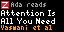

# Zotero Reading

Shows the paper you most recently **highlighted** in Zotero on a Tronbyt/Tidbyt: title, authors, your name and the Zotero logo. Highlights are the signal, so papers you open but never annotate don't count.

## Layouts

- **Simple**: the latest paper.
- **With stats**: alternates with your streak (consecutive days with a highlight) and highlights this week.
- **Reading buddies**: two people, one per half of the screen.

After N days without highlights (default 7), the paper is replaced by a rotating motivational message. Tick **Show days since last read** to keep the paper on screen with "N days ago" instead.

## Setup

1. Go to zotero.org → Settings → Security → Applications → **Create new private key** (or https://www.zotero.org/settings/keys/new).
2. Tick **Allow library access** and leave write access off. Save, then copy the key.
3. The same page shows "Your user ID for use in API calls is …". That number is your user ID.
4. Add the app on your Tronbyt and fill in name, user ID and key. For Reading buddies, fill in the buddy fields too.

Only your personal library is read (not group libraries). Zotero is asked at most once every 15 minutes.

## Credits

Created by kalxed using Claude Code
